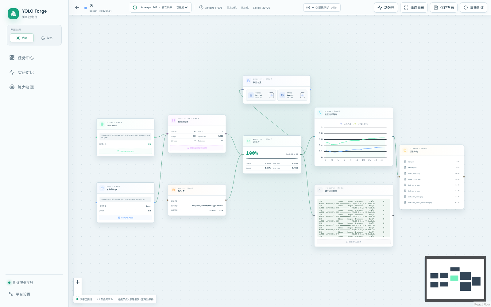
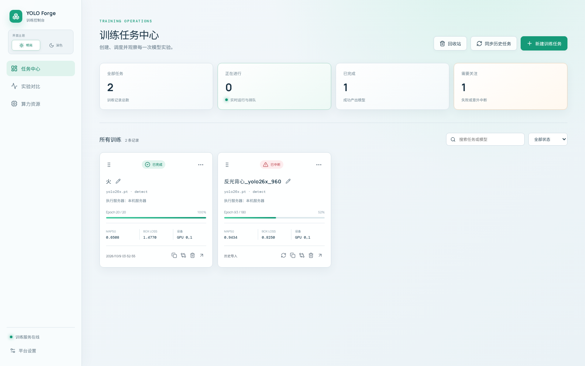
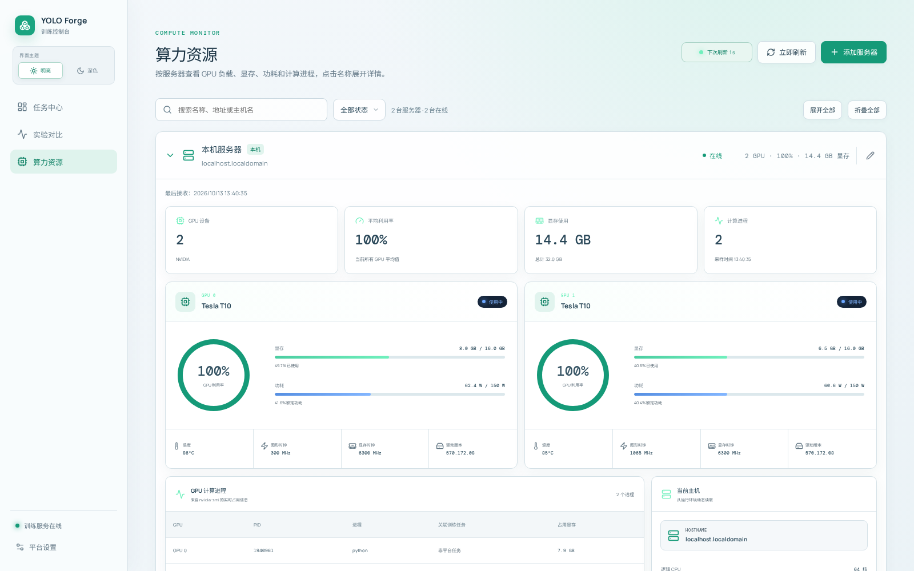
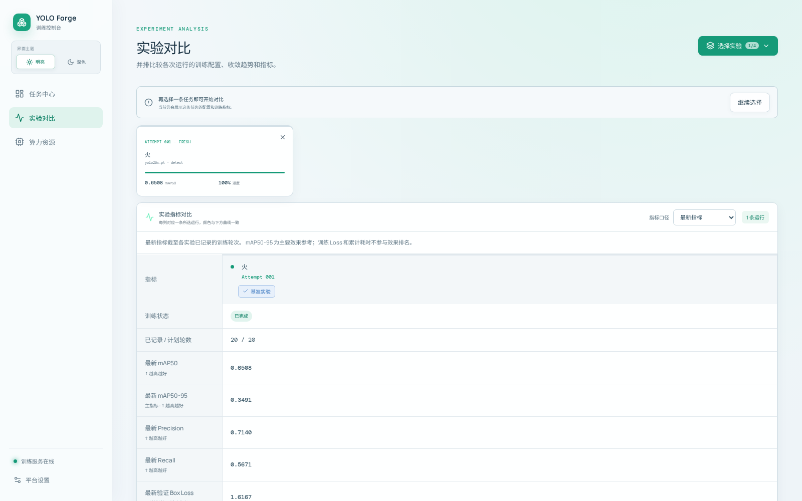

# YOLO 模型训练平台 · YOLO Forge

一个基于 Ultralytics 的可视化模型训练平台。通过浏览器创建和管理训练任务，查看训练进度、指标曲线、日志和模型权重，并对比不同实验的效果。

平台使用 FastAPI 调用服务器上的 `yolo` CLI 执行训练，使用 React Flow 展示训练画布，使用 ECharts 绘制指标曲线。中心平台管理本机训练；其他服务器通过独立 Agent 汇总算力数据，显式启用训练后可从同一界面管理远程任务。训练使用执行服务器自己的环境，输出保存在对应服务器。

本文说明平台的安装与基本使用；页面操作见 [Web 平台说明](web/README.md)，远程接入见 [Agent 说明](web/agent/README.md)，服务维护见 [部署说明](web/deploy/README.md)。架构、代码职责、验证结果和当前改进建议集中记录在 [项目分析](docs/project-analysis.md)。当前平台版本为 **1.1.0**，随仓库提供的远程 Agent 为 **1.8.1**。

## 界面预览

<p align="center">
  
</p>
<p align="center"><sub>可视化训练画布 · 数据集、模型、参数、训练状态、指标、日志与产物集中呈现</sub></p>

<table>
  <tr>
    <td width="50%" align="center">
      
      <br><sub>训练任务中心</sub>
    </td>
    <td width="50%" align="center">
      
      <br><sub>多服务器算力监控</sub>
    </td>
  </tr>
  <tr>
    <td colspan="2" align="center">
      
      <br><sub>实验配置与指标对比</sub>
    </td>
  </tr>
</table>

## 主要功能

| 功能 | 说明 |
| --- | --- |
| 任务管理 | 新建、排队、启动、停止、断点续训和重新训练；拖动卡片调整显示顺序 |
| 克隆与重命名 | 克隆自动生成“原名称 - 副本 1、2…”；点击名称右侧的铅笔按钮修改任务名称 |
| 训练分组 | 按实验主题折叠和整理任务；支持命名未分组任务、重命名、移动任务和删除分组 |
| 训练画布 | 展示数据集、基础模型、训练参数、指标、日志和训练产物，可双击对应节点查看或编辑 |
| 参数配置 | 表单编辑、粘贴参数导入、JSON 查看；显示识别结果及未识别参数提示 |
| 参数能力表 | 后端读取当前 Ultralytics 的 `default.yaml`，生成训练相关参数目录 |
| 数据集上传 | 选择本地 YOLO 检测数据集文件夹，校验目录、图片和标签，自动生成配置 |
| 数据集管理 | 查看平台上传数据集的规模、类别、警告和任务引用；安全删除未被引用的数据集 |
| 实验对比 | 从任意任务选择任意历史 Attempt，支持同一任务的多次运行对比；浏览器可将同时对比上限设为 2～8 |
| 训练历史 | 每次运行使用独立的 `Attempt` 编号，保留参数快照、指标、日志和权重 |
| 模型测试历史 | 按任务持久保存测试参数、原图、结果图和下载文件；支持按 Attempt 筛选、重测和显式删除 |
| 多服务器算力监控 | 手动添加服务器，按名称折叠；搜索和状态筛选，查看 GPU、进程及主机资源 |
| 远程任务管理 | 选择执行服务器，使用远程模型和数据路径；支持停止、续训、重新训练、产物预览下载与 Agent 确认后的永久删除 |
| 历史导入与回收站 | 导入已有 Ultralytics 训练结果，支持任务移入回收站、恢复和永久删除 |
| 界面与访问性 | 任务中心、算力资源、实验对比和训练画布按窗口宽度自适应；核心弹窗支持 Esc 关闭、焦点限定和关闭后恢复焦点 |
| 平台状态 | 侧栏显示真实健康状态；设置弹窗查看平台版本、数据库、核心工作线程、调度异常、实例和训练输出目录 |

本机调度器根据本机活动任务配置的 GPU 编号安排训练，不依据实时显存余量调度；远程任务的同编号 GPU 不会阻塞本机队列。队列任务使用数据库条件更新原子地进入 `starting`，并在创建 YOLO 进程前持久化启动意图，减少停止请求与启动线程竞争导致重复或失控启动。远程任务按服务器排队，同一节点一次执行一项平台训练。平台外启动的训练进程不属于调度器的管理范围。

## 技术栈

- **前端**：React 19、TypeScript、Vite、React Flow、ECharts、Lucide Icons。
- **后端**：Python 3.11+、FastAPI、SQLAlchemy、SQLite（WAL 模式）。
- **训练**：仓库中的 Ultralytics 源码、PyTorch、YOLO CLI。
- **远程 Agent**：Linux / POSIX、Python 3.9+ 标准库；监控本身无需安装训练依赖。

## 项目结构

```text
.
├── README.md                 # 项目首页说明
├── docs/                     # 项目分析与 screenshots/ 界面截图
├── ultralytics/              # 训练框架源码、配置及框架文档
├── web/
│   ├── frontend/             # Web 界面
│   ├── backend/              # API、数据库模型和训练调度器
│   ├── agent/                # 算力监控与可选远程训练 Agent
│   ├── deploy/               # systemd 服务模板
│   ├── .env.example          # 环境变量配置示例
│   ├── README.md             # Web 平台补充说明
│   └── data/                 # 运行时生成的数据库、日志和训练输出
├── models/                   # 本地模型权重目录（按需准备）
├── pt/                       # 本地模型权重备用目录（按需准备）
└── 数据集/                   # 本地数据集及上传结果（按需准备）
```

模型权重、数据集、前端构建产物和平台运行数据需要在部署时准备或生成，不应依赖仓库提供本地训练数据。

## 安装与启动

### 1. 准备环境

建议使用 Linux、Python 3.11 及以上版本、Node.js 20 和 npm。使用 NVIDIA GPU 训练时，需要安装相应驱动及兼容的 PyTorch CUDA 版本，可通过 `nvidia-smi` 检查设备。

以下命令在已激活的 Python 或 Conda 环境中执行。请先根据训练服务器选择合适的 [PyTorch 安装方式](https://pytorch.org/get-started/locally/)，再安装项目依赖。

```bash
git clone https://github.com/scsg666g/yolo-xlpt.git
cd yolo-xlpt

# 安装仓库内的训练框架及平台后端
python -m pip install -e ./ultralytics
python -m pip install -e './web/backend[dev]'
```

### 2. 构建前端

在项目根目录执行：

```bash
cd web/frontend
npm ci
npm run build
cd ../..
```

构建结果位于 `web/frontend/dist/`，由后端直接提供访问。

### 3. 启动服务

在项目根目录执行：

```bash
# 使用当前 Python 环境安装的 YOLO CLI
export YOLO_BIN="$(command -v yolo)"

cd web/backend
python -m uvicorn app.main:app --host 0.0.0.0 --port 18088 --workers 1
```

浏览器访问：

- 平台首页：`http://服务器地址:18088/`
- 算力资源：`http://服务器地址:18088/compute`
- 数据集管理：`http://服务器地址:18088/datasets`
- API 文档：`http://服务器地址:18088/docs`

**保持 `--workers 1`**：训练调度器和本机删除工作线程运行在 API 进程内，多进程启动会导致多个调度器同时运行。同一数据库和运行目录也不能由多个后端实例共享。正式部署使用 [部署说明](web/deploy/README.md) 中对应的开发版或使用版模板，并替换项目目录、Python 路径和运行账户。

侧栏服务状态在页面可见时每 30 秒读取一次 `/api/health`。“平台设置”可切换当前浏览器的主题，并查看平台版本、数据库延迟、训练调度器、文件清理、模型测试线程、平台实例及训练输出目录。调度循环报错时，健康接口会返回 `scheduler=error`、当前错误、最近错误及时间，前端同步标记服务异常；下一轮成功后当前错误清除，最近错误仍保留供排查。

### 4. 配置服务器路径（可选）

默认项目路径从源码位置推导，默认数据保存到 `web/data/`。如果需要调整目录，可以参考 [环境变量示例](web/.env.example)。

| 环境变量 | 用途 |
| --- | --- |
| `PLATFORM_INSTANCE_NAME` | 健康接口返回的实例名称；未设置时使用源码所在项目目录名称 |
| `PLATFORM_VERSION` | 可选的运行时版本覆盖；通常保持未设置，由根目录 `VERSION` 提供版本 |
| `YOLO_PROJECT_ROOT` | 项目根目录 |
| `ULTRALYTICS_ROOT` | 仓库内 Ultralytics 目录 |
| `YOLO_BIN` | 训练环境中 `yolo` 命令或可执行文件路径 |
| `PLATFORM_DATA_ROOT` | 平台运行数据根目录 |
| `PLATFORM_RUNS_ROOT` | 训练结果保存目录 |
| `PLATFORM_RUNTIME_ROOT` | 训练运行时配置目录 |
| `PLATFORM_LOG_ROOT` | 本机训练日志目录，不包含 Uvicorn 访问日志 |
| `DATABASE_URL` | 数据库连接地址，默认使用 SQLite |
| `NVIDIA_SMI_BIN` | `nvidia-smi` 命令或绝对路径 |
| `PLATFORM_MKL_THREADING_LAYER` | 训练进程 MKL 线程设置，默认 `GNU` |
| `PLATFORM_MODEL_TEST_HISTORY_QUOTA_BYTES` | 持久模型测试历史总配额，默认 20 GiB；`0` 表示关闭该配额 |
| `PLATFORM_MODEL_TEST_TASK_QUOTA_BYTES` | 单个训练任务的模型测试历史配额，默认 5 GiB；`0` 表示关闭该配额 |
| `PLATFORM_MODEL_TEST_MIN_FREE_BYTES` | 模型测试所在磁盘必须保留的最低可用空间，默认 2 GiB；`0` 表示关闭该检查 |
| `PLATFORM_MODEL_TEST_IMAGE_RESERVE_BYTES` | 每张图片为规范化原图、结果图和 ZIP 预留的空间，默认 64 MiB |

`YOLO_BIN` 未设置时，后端先查找当前 Python 环境同目录的 `yolo`，再查找 `PATH`；如需锁定某个训练环境，再显式设置命令或路径。直接启动 Uvicorn 不会自动读取 `web/.env`；需要将变量导入环境，或由 systemd 的 `EnvironmentFile` 加载。平台版本的单一仓库源是根目录 `VERSION`：Vite 构建将它注入品牌区，FastAPI 和健康接口也读取它；后端安装包版本作为源码文件不可用时的回退。

相对目录与相对 SQLite 地址按项目根目录解析。仅设置 `PLATFORM_DATA_ROOT` 不会改变数据库默认地址 `sqlite:///web/data/platform.db`，也不会迁移已有文件；迁移必须同时核对 `DATABASE_URL` 和各输出目录。若未单独设置运行、运行时和日志目录，它们随数据根目录推导；示例文件显式设置的目录则以各自变量为准。

## 多服务器算力监控

中心平台仍运行在当前服务器。打开“算力资源”，点击“添加服务器”，填写服务器名称、地址或 IP、备注和上报间隔。保存后下载 `monitor_agent.py` 与该节点的专属 `agent-config.json`，将两个文件放到需要监控的服务器上。

地址字段用于识别服务器；接入依靠远程 Agent 主动上报，不通过 SSH 登录。配置中的“中心平台地址”必须能从远程服务器访问，例如 `http://<中心服务器地址>:18088`。仅填写远程 IP 不会自动获取资源信息。

远程 Agent 当前面向 Linux / POSIX，使用 `fcntl` 文件锁、进程组信号和 Linux 主机信息；Python 3.9+ 即可运行监控，无需安装平台前端、后端或第三方 Python 依赖。启用训练时仍需另外准备 Ultralytics、PyTorch 和模型、数据集。NVIDIA GPU 指标通过该服务器的 `nvidia-smi` 读取；没有 GPU 时仍可上报主机信息。在两个下载文件所在目录执行：

```bash
chmod 600 agent-config.json
python3 monitor_agent.py --config agent-config.json --check-config
python3 monitor_agent.py --config agent-config.json --once

# 看到“采样上报成功”后，持续运行
python3 monitor_agent.py --config agent-config.json
```

服务器按名称折叠，收起时显示状态及 GPU 摘要，展开后展示 GPU 利用率、显存、功耗、温度、时钟、计算进程及主机信息。支持搜索、状态筛选、全部展开或折叠；服务器资料和最近采样保存在中心数据库，展开状态保存在当前浏览器。

每台远程服务器使用独立 Token，数据库只保存哈希。创建或重新生成 Token 时，应保存下载的配置；重新生成后，旧 Token 立即失效，需要更新对应 Agent 配置并重启 Agent。禁用节点会拒绝 Agent 请求，不能代替停止训练。移除节点前须先清理关联任务，移除本身不删除远程文件或停止进程。

Agent 默认只监控；在远程配置启用训练并限定模型、数据 YAML 和输出目录后，可从平台创建远程训练任务，查看进度、指标和日志。当前脚本版本为 **1.8.1**，远程训练最低兼容版本仍为 **1.8.0**：中心在创建、启动、续训、重新训练和 Agent 领取阶段都校验最低版本、中心接收时间 `last_seen_at` 和 `training.ready`。节点过期、环境未就绪或版本过旧时会明确拒绝新训练，Agent 自身也会在未就绪时暂停领取。模型测试历史本身没有新增 Agent 协议；新版开发平台可使用 Agent 1.8.1 上报的输出目录，在新建任务时提示和校验远程路径；旧中心接入新版 Agent 不会自动获得这些页面功能。

Agent 1.8.0 起在用户状态目录中为每个训练输出根建立层级意向锁：相同或父子根目录互斥，不相交的兄弟目录可并行，不再要求两个 Agent 恰好填写同一个 `training_lock_file`。若两个 Agent 仍显式共用同一个传统锁文件，该锁仍会串行它们的训练。workspace 登记的 owner 由稳定 `node_id` 生成；共享输出根中存在其他存活 Agent 时，会拒绝永久删除，避免一套平台删掉另一套仍在使用的产物。断网时不把未确认的文件清理显示为成功；输出根目录消失或挂载离线时，删除明确失败并保留记录供重试。远程任务停止卡住至少 30 秒后，只有在远程服务器确认对应 YOLO 进程已结束，才能在训练画布使用“解除占用”。部署步骤、开机启动和故障排查见 [Agent 说明](web/agent/README.md)。

Agent 配置以合法 JSON 的 `_comments` 字段附带中文说明。`training_cwd` 相对配置文件目录解析，允许目录、输出目录、锁文件以及带 `/` 的相对 `yolo_bin` 基于 `training_cwd`；单独的 `yolo` 仍通过 `PATH` 查找，绝对路径也继续兼容。迁移服务器时按实际布局调整配置并运行 `--check-config`，无需修改脚本中的路径。两套平台应使用互不重叠的输出根和各自的节点身份，历史 Attempt 不会随配置改动自动迁移。

## 数据集准备

### 通过网页上传

在“新建训练任务”窗口的数据集区域点击“上传数据集”，或在侧栏“数据集管理”页面点击“上传数据集”，选择包含以下结构的最外层文件夹：

```text
火焰数据集/
├── images/
│   ├── train/                # 训练图片
│   └── val/                  # 验证图片
└── labels/
    ├── train/                # 对应训练标签 .txt
    └── val/                  # 对应验证标签 .txt
```

当前上传入口支持 **YOLO 目标检测数据集**。图片与标签使用相同的文件名，例如 `images/train/001.jpg` 对应 `labels/train/001.txt`。

标签每行表示一个目标：

```text
类别编号 中心x 中心y 宽 高
0 0.50 0.50 0.20 0.30
```

类别编号从 `0` 开始，坐标与尺寸归一化到 `0～1`，宽高必须大于 `0`。类别名称可以在上传窗口填写，也可从目录中的 `data.yaml`、`data.yml` 或 `classes.txt` 读取。缺少标签或空标签的图片可作为背景图，完成检查时会显示提醒。

上传后保留原文件夹名称，保存到 `数据集/<原文件夹名>/`，自动生成 `data.yaml` 并选中该数据集。配置中的 `path` 使用服务器上的实际绝对路径。同名目录会拒绝上传，避免覆盖已有数据。

支持 JPG、JPEG、PNG、BMP、WEBP、TIF、TIFF；单张图片最大 256 MiB，标签或配置文件最大 4 MiB，单次上传最大 50 GiB、20 万个文件、1000 个类别。训练和验证图片目录都必须至少有一张图片。发布时临时上传与目标副本会同时存在，应准备接近数据集两倍的磁盘空间。详细的格式要求、暂停和重试说明见 [Web 平台文档](web/README.md#上传数据集)。

### 管理平台上传的数据集

“数据集管理”只列出由平台成功上传并带有管理标记的数据集，可查看训练/验证图片数、标签、类别、空间占用、上传警告和引用任务。手工放入 `数据集/` 的目录仍可作为训练输入，但不会出现在管理列表中，也不会被该页面删除。

只有没有本机任务引用的平台数据集才能永久删除；回收站中的任务也计入引用。应先为这些任务更换数据集，或永久删除任务。远程任务中的同名或同字符串路径属于远程服务器，不作为本机数据集引用。删除是不可恢复操作；平台会先将目录从可发现资源中移除，再清理文件。

### 使用服务器已有数据集

将数据集配置放在项目的 `数据集/` 或 `ultralytics/xl/` 下，在创建任务时选择对应 YAML 文件。例如：

```yaml
path: /服务器上的数据集目录/火焰数据集
train: images/train
val: images/val
names:
  0: fire
```

将 `path` 替换为实际路径。基础模型权重可放在 `models/`、`pt/` 或 `ultralytics/weights/` 下，供平台发现并选择。

## 使用流程

1. 打开“算力资源”，确认服务器和 GPU 状态。
2. 新建训练任务，填写名称，选择模型、数据集、GPU 和训练参数。
3. 启动任务，进入训练画布查看进度、曲线、日志及训练产物。
4. 需要调整方案时，克隆任务并修改配置；名称旁的铅笔按钮可随时重命名。
5. 在“实验对比”中选择不同运行，查看指标和参数差异。判断训练效果时，应同时考虑数据集、验证方式及训练是否完成。

任务名称是展示名称，重命名不会移动权重、修改训练参数或改变已有日志路径。

任务中心按分组展示训练任务。“未分组”是系统区域；点击其名称旁的铅笔可创建正式分组并一次移入当前任务。正式分组可重命名或删除；删除分组只会将组内任务放回“未分组”，不会删除任务、训练记录或文件。

## 训练结果与历史

平台创建的每次训练运行使用独立目录：

```text
web/data/runs/<任务类型>/<任务ID>/attempt-001/
web/data/runs/<任务类型>/<任务ID>/attempt-002/
```

每个 `Attempt` 保留自身的训练参数快照、指标和产物。平台也可以导入 `ultralytics/runs/` 下已有的训练记录；历史导入不会移动原训练文件。

模型图片测试的索引和状态保存在 SQLite 的 `model_tests`、`model_test_images` 表，原图、结果图、汇总和 ZIP 等文件保存在 `PLATFORM_DATA_ROOT/model-test-history/<任务ID>/<测试ID>/`。创建测试时会按权重副本、上传图、规范化原图、结果图和 ZIP 的保守组合预留磁盘空间，同时检查总配额、任务配额和最低可用空间；服务会返回明确的空间不足原因，而不是在写入中途才失败。完成、失败或取消后预留会释放为实际占用。关闭测试弹窗时，已经准备、排队或运行的服务端测试会继续；尚在上传的记录会尝试放弃并标记为已取消，如果启动已经先成功则继续运行，最终状态可在历史页确认。完成、失败和取消记录会一直保留，直到显式删除记录或永久删除任务。任务移入回收站时历史仍保留，恢复后重新可见；中心历史属于整套永久删除流程，删除任务记录前必须完成清理，任何一步失败都保留可重试状态。远程测试完成后，原图和结果已保存在中心，即使远程 Agent 离线也能继续查看和下载。

回收站先隐藏任务记录；永久删除本机任务或远程任务都先返回“已受理”，再由后台线程或 Agent 清理文件，成功后删除记录。本机清理只处理明确允许根目录下的任务运行和运行时目录；遇到顶层或中间符号链接时仅移除链接，不跟随到指向的外部目录。清理中或清理失败的任务不能恢复，因为文件可能已部分删除。具体操作边界见 [Web 平台说明](web/README.md#回收站与永久删除)。

训练日志默认单独保存在项目的 `web/data/log/`，命名为 `年月日_任务ID_attempt-编号.log`，例如 `20261012_<任务ID>_attempt-001.log`。不同运行的日志独立保存，避免混在一起；这与终端中的 Uvicorn 访问日志不同。可通过 `PLATFORM_LOG_ROOT` 调整位置。

**当前日志窗口与完整文件有区别**：本机窗口请求最近 240 行，远程默认仅回传最近 100 行。“复制全部”和“下载日志”目前都只处理页面收到的尾部，下载按钮不下载服务器完整日志文件；HTTP 内网地址下复制还可能受浏览器安全环境限制，日志中的 ANSI 控制字符也尚未清理。需要完整日志时按窗口显示的路径在实际执行服务器获取，详见 [日志查看与导出](web/README.md#日志查看与导出)。

默认数据库为 `web/data/platform.db`，其中也保存服务器资料、最近采样、Agent Token 哈希和模型测试历史索引。迁移部署时，应一起备份数据库、`PLATFORM_DATA_ROOT/model-test-history/`、训练结果、日志，以及模型和数据集文件，并核对配置中的绝对路径；中心平台地址改变后，还需要更新远程 Agent 的 `center_url`。数据库和 `model-test-history/` 是同一份模型测试历史的两部分，必须成套备份和恢复。SQLite Backup API 只保证数据库快照一致，不包含历史文件，也不会冻结并发的测试、上传或删除；需要严格匹配的备份时，应先停止或静默目标服务，确认没有相关操作进行，再备份数据库并复制历史目录。确认没有活动模型测试后，`model-test-work/` 无需备份；若在活动测试期间备份，其中有效的固定权重副本必须与数据库状态保持同一时点。

## 开发与维护

前端开发可在 `web/frontend/` 执行 `npm run dev`；开发服务器默认将 `/api` 请求代理到 `http://127.0.0.1:18088`，因此仍需启动后端。

后端测试应隔离运行数据。在项目根目录执行：

```bash
cd web/backend
test_data_root="$(mktemp -d)"
PLATFORM_DATA_ROOT="$test_data_root" \
PLATFORM_RUNS_ROOT="$test_data_root/runs" \
PLATFORM_RUNTIME_ROOT="$test_data_root/task_runtime" \
PLATFORM_LOG_ROOT="$test_data_root/log" \
DATABASE_URL="sqlite:///$test_data_root/test-platform.db" \
python -m pytest -q tests
```

前端静态检查和构建在 `web/frontend/` 执行 `npm run lint`、`npm run build`。每次发布都应重新运行后端测试、前端 lint、生产构建、三份 Agent 脚本的语法检查和 `--check-config`；不沿用上一版的用例数量作为当前结果。自动化检查不代表真实 GPU/DDP 和跨服务器网络故障已经验收。

修改前端后重新执行 `npm run build`；修改后端后重启服务。后端启动会自动创建算力节点和远程文件操作队列表，并注册本机。本次 Agent 升级至 1.8.1，最低兼容版本仍为 1.8.0；升级前应确认没有运行中的训练，备份脚本和配置并保留 `.training-state/`。本次输出目录修复需要一并合并对应配置，保留原节点身份，不能只替换脚本。当前未内置登录认证，Agent Token 仅验证对应节点的 Agent 接口；如需开放给其他用户，应在部署网关配置访问认证和 HTTPS。双实例的端口、备份及安装步骤见 [部署说明](web/deploy/README.md)。

## 相关文档

- [Web 平台说明](web/README.md)
- [远程算力 Agent 接入与维护](web/agent/README.md)
- [双实例部署、备份与排障](web/deploy/README.md)
- [项目架构、当前问题与维护建议](docs/project-analysis.md)
- [Ultralytics 框架说明](ultralytics/README.md)
- [Ultralytics 许可证](ultralytics/LICENSE)

仓库内 Ultralytics 组件的许可证信息以其说明及许可证文件为准。
