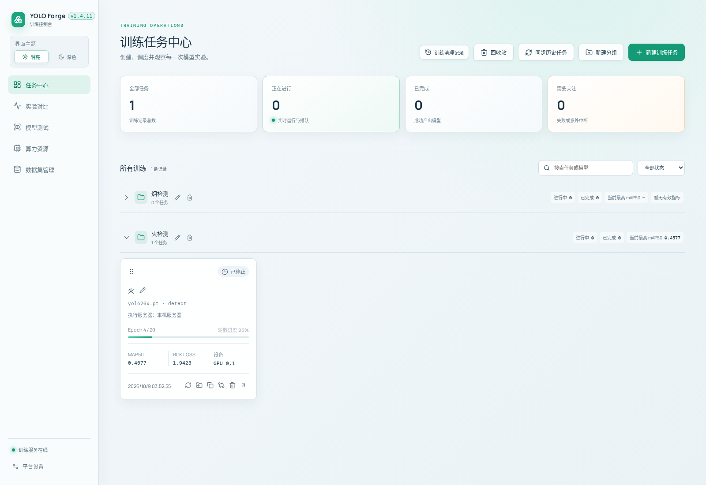
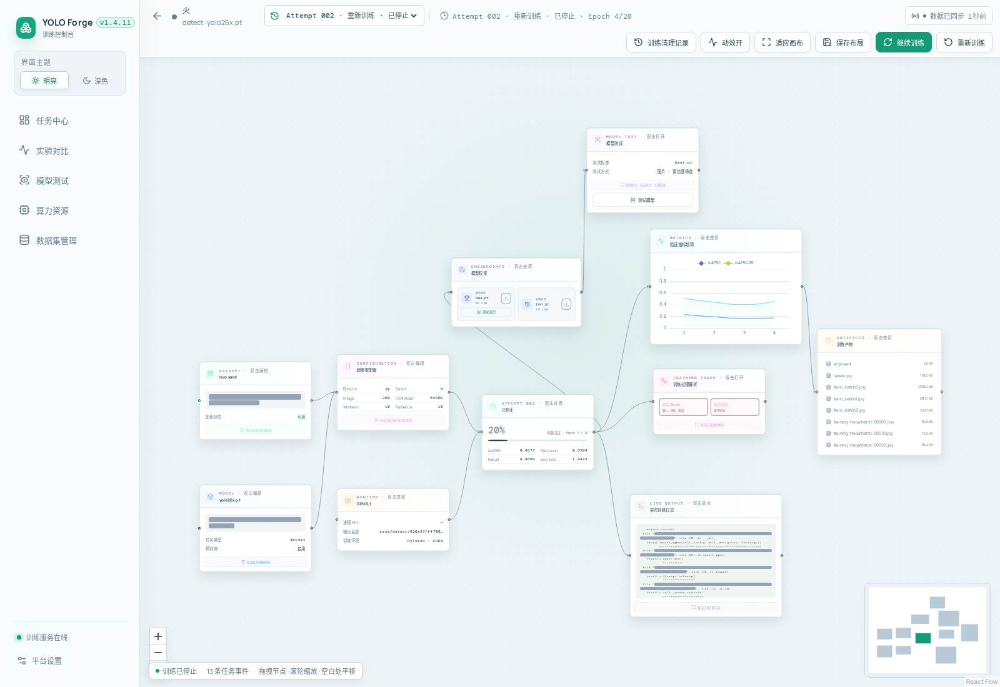
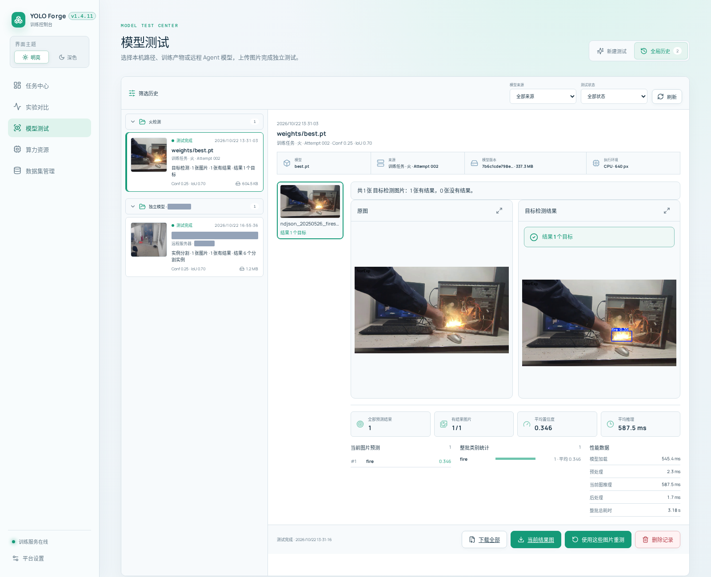
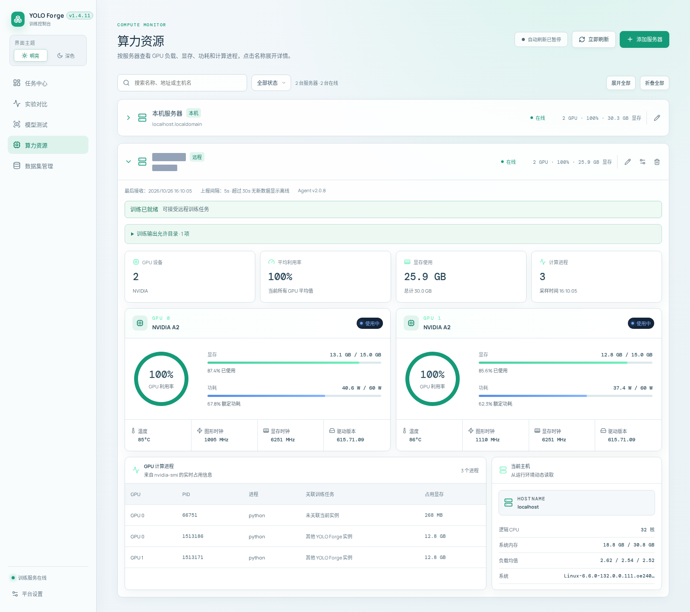
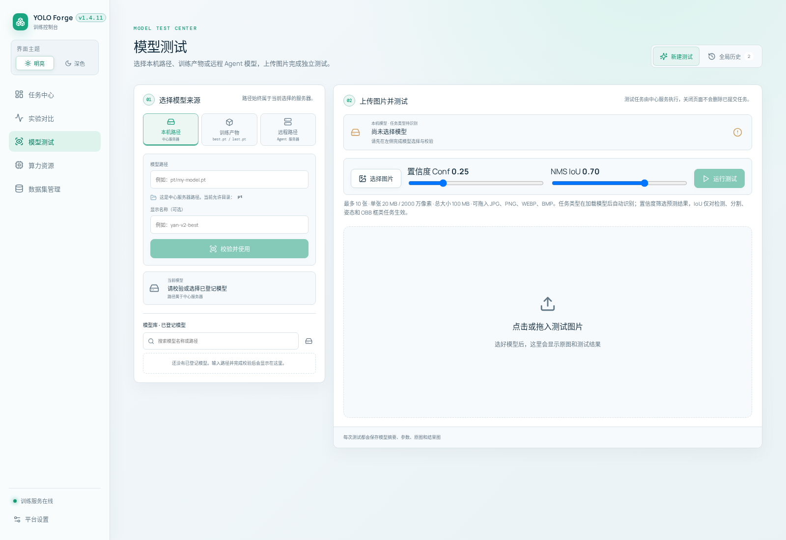
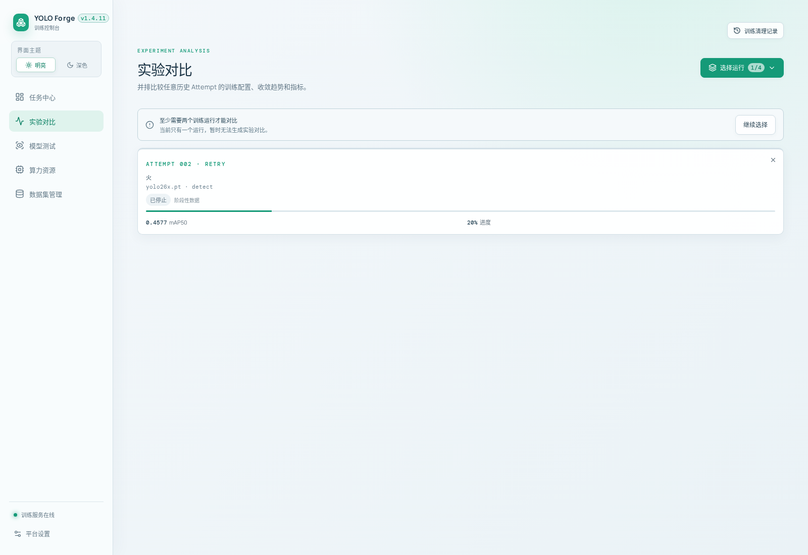
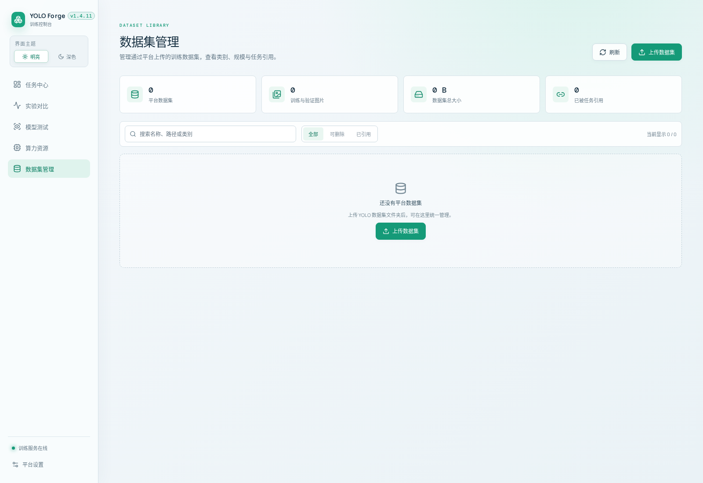

# YOLO 模型训练平台 · YOLO Forge

## 1.13.0 数据集设置与中转空间诊断

平台设置新增“数据集”分类，集中管理本机与远程保存位置、平台中转空间、临时文件清理状态和重新加载资源预算。原始数据集大小来自数据库登记，临时空间通过有边界的后台采样统计，分别展示采样时间和不完整结果；打开设置不扫描原始图片或触发文件清理。数据集管理页面继续提供保存位置快捷入口。

中转配额、失败快照保留期限和平台重新加载的读取预算可在页面保存到当前实例；未设置时继承现有环境配置。成功与取消的中心快照在执行者释放后回收，浏览器上传暂存仍按现有保留期清理，失败快照保留期限设为 `0` 表示关闭过期回收。修改默认保存位置只影响新上传；历史目录、登记、任务与原始文件不迁移。远程 Agent 的导出限速仍由节点自身配置，页面展示最近上报及离线状态。

平台版本 **1.13.0**，Agent 保持 **2.6.3**，无需更新两个独立 Agent 包。仅修改开发版，未复制或同步使用版。

## 1.12.5 删除数据集登记与页面内接管

卡片上的“删除登记”真正移除数据库登记行，保留原始数据集、任务和历史实验；支持本机、远程和正在训练时操作。登记删除与永久删除文件使用独立接口和确认窗口，文件清理位于“文件操作”中，继续检查引用和内容指纹。接管文件改为页面内弹窗，输入完整目录确认。

旧目录兼容登记改为每个可用根目录首次导入，删除登记后刷新或重启不会自动恢复卡片；旧上传客户端的新发布仍会主动创建登记。保留的操作凭据维持历史任务的路径访问，扫描或手动登记可重新建立新卡片。平台版本 **1.12.5**，本次无需修改或升级 Agent；仅修改开发版。

## 1.12.4 训练期间删除无关数据集

已接管且没有任务或历史引用的数据集可在其他数据集训练期间删除。删除、训练启动及重新领取继续核对服务器、真实路径和配置证据；同目录、间接引用、无法核验的活动训练仍受保护。远程并发删除通过 Agent 2.6.3 的能力上报协商，旧 Agent 保持原互斥行为。卡片显示不可删除原因，确认时显示服务器和完整目录，提交与真正清理完成分别提示。

开发平台版本为 **1.12.4**，配套 Agent 为 **2.6.3**。历史数据保留原编号、路径和操作记录，无需清空或批量回填；本次只更新开发版与两个独立 Agent 分发包，使用版平台不复制或同步。远程脚本由维护者部署，保留节点配置、Token 和历史状态。

## 1.12.3 数据集中转包与历史 Attempt 清理

数据集登记、上传、复制、迁移及重新加载成功后，中心平台在归档读写结束时回收中转快照；取消后等待本地执行或远程校验退出，再由后台回收。历史成功/取消操作留下的中转包也会在新版后台扫描时清理。失败操作仍按原期限保留供重试，浏览器上传暂存会话仍保留原期限供结果查询和重复提交；原始数据集、已发布目录与操作记录不受清理影响。

续训 Attempt 已完成但只有 `last.pt` 可能是正常现象：本轮没有超过历史最佳成绩时，训练器不会在新目录生成 `best.pt`。删除旧 Attempt 时，已结束的后继只要有经校验的独立 `last.pt`，且旧源没有可用的最佳权重，便可安全清理已经缺失的历史目录或记录；仍依赖历史最佳权重、源本身也是续训、权重不完整或路径不可验证时继续阻止。来源路径会保存在后继历史中，不把 `last.pt` 冒充最佳权重。远程场景要求 Agent 2.6.2 在删除前核实旧 `best.pt` 真正不存在；确认删除后执行前和记录收尾时继续核对引用，避免留下悬挂的检查点路径。实验对比的删除弹窗可重新检查并显示阻止原因。

开发平台版本为 **1.12.3**，配套远程 Agent 为 **2.6.2**；数据集中转清理不需要修改 Agent 协议，历史 Attempt 远程安全删除需新 Agent 校验。仅修改开发版平台和两个独立 Agent 包；使用版平台由维护者在合适时机单独部署。

## 1.12.2 指标与页面刷新可靠性

本地训练的 `results.csv` 被替换或截断后，以当前 Attempt 的有效记录更新指标，避免旧 Epoch 混入曲线。远程 Agent 2.6.1 在新版中心协商后可发送同一 Attempt 的指标重置和补传；旧 Agent、旧中心和历史 Attempt 沿用原协议，不要求迁移或清空数据。CSV 暂时缺失或尚无有效记录时保守保留旧指标，等待下一次完整记录。

训练画布的指标、日志、事件和产物分别刷新；单项请求失败时保留该 Attempt 已有内容并显示错误，切换 Attempt 不沿用上一运行的数据。数据集删除预检查只接受最后一次点击的结果。任务中心在浏览器标签隐藏时暂停轮询，恢复可见立即刷新；实验对比仍按原周期刷新活动和选中的运行，完整历史目录改为五分钟刷新。本地产物目录暂不可用或扫描失败时保留登记记录，完整扫描确认消失后才清理。新增可按 checkout 位置生成 systemd unit 的离线工具，现有静态服务模板不变。

开发平台版本为 **1.12.2**，远程 Agent 为 **2.6.1**。此仓库的源码修改不会自动替换正在运行的训练进程；训练期间不要通过普通 `systemctl restart/stop` 更新 Agent 或中心服务。需要应用新 Agent 时先按 [保留训练重载说明](web/agent/README.md) 核对实际运行版本和服务配置，再由维护者选择安全时机。使用版平台由维护者单独更新，本次未同步其目录。

## 1.12.1 降批重试显存回收

首次训练 OOM 自动降批时，先退出异常处理并释放失败前向传播的张量引用，再清理缓存及重建训练管线，避免异常回溯占用显存造成不必要的第二次降批。降批记录格式保持不变，历史及正在运行的 Batch 显示继续按现有日志兼容；该修复仅对更新后新启动的训练进程生效。Agent 仍为 **2.6.0**，无需更新两个独立 Agent 包；远程训练环境须单独更新仓库中的 Ultralytics 源码。

## 1.12.0 训练采样、历史记录与数据集保护

本机与远程训练的过程采样遵守间隔和数量上限；采样异常不再中断训练，达到上限后释放回调与张量引用。本机 GPU 按预约的 UUID 绑定并转换训练命令中的逻辑编号；继承数字 `CUDA_VISIBLE_DEVICES` 时使用独立 CUDA 驱动探针核验实际可见 UUID，无法核验则保留排队并提示检查配置。新训练保留物理编号、UUID 与逻辑编号的绑定快照和日志，历史运行命令不改写。

数据集上传、登记和重新加载统一拒绝空训练集/验证集，接管及删除保护保存位置根目录，批量目录查询减少重复数据库读取，终态上传中转文件可重试回收。历史训练引用按当时的执行节点校验，任务换服务器后仍保护原数据。远程已校验压缩包复用文件身份，变化时重新完整校验。

五类任务统一显示对应指标；实验对比仅在历史配置和数据校验证据一致时标记排名和改善。模型测试历史保留已加载分页并更新活动记录，接口增加有限等待及不确定提交结果提示，未知 API 返回 JSON 404。Agent 在中心已有可信完成删除记录时归档丢失确认的终态回执，未知情况继续保留。

该版开发平台为 **1.12.0**，配套 Agent 为 **2.6.0**。历史数据无需清空或回填；两个独立 Agent 分发包只更新脚本和说明，保留节点配置与状态。使用版平台目录不修改。更新后仍需按各环境维护流程构建前端、重启后端，并由维护者部署远程 Agent。

## 1.11.0 训练期间的数据集只读重新加载

本机“重新加载”使用独立的后台执行通道，远程 Agent 通过能力上报协商训练期间的只读导出。新采样先在独立中转区完成扫描、打包和校验，源文件变化则保留旧统计并提示重试；同路径写入或删除仍等待，其他目录检查和训练调度不被长时间校验占住。训练期间的读取有可配置速率、磁盘空间保留和 I/O 压力暂停，操作记录显示排队、暂停与实际进度。旧 Agent 保持原有等待规则，历史任务和数据集无需迁移。

该版本平台为 **1.11.0**，配套 Agent 为 **2.5.3**。只更新开发版与两个独立远程 Agent 分发包，不修改使用版平台。详见 [Web 平台说明](web/README.md) 和 [Agent 说明](web/agent/README.md)。

## 1.10.0 训练追溯与运行可靠性

数据集引用状态随任务变化刷新；登记、重新加载和远程缓存清理增加请求幂等、过期回收与状态核验，同名不同扩展名图片会明确报错。训练启动记录配置摘要和匹配到的数据集校验快照，历史 Attempt 缺少记录时保持“未记录”。本地和远程指标改为增量读取，并处理文件替换、同 Epoch 更正、半写入行和 Agent 重启；Agent 日志从文件尾读取。健康检查覆盖数据集工作线程，模型测试说明在中心 CPU 单通道执行且超时可配置。

平台版本升至 **1.10.0**，配套 Agent 升至 **2.5.0**。新 Agent 信息通过能力协商发送，旧中心和历史数据继续兼容。只更新开发平台和两个独立 Agent 分发目录，没有修改使用版平台。

## 1.9.0 算力监控即时刷新

算力资源页的“立即刷新”会等待本机完成一次新采样，并在支持该能力的远程 Agent 上请求即时上报；页面分别显示新采样、等待、超时或旧 Agent 不支持等结果，失败时保留上次可信数据。每五秒自动刷新继续使用缓存，避免频繁采集阻塞页面。历史节点和旧版 Agent 不需要迁移；旧 Agent 仍按既有间隔上报。配套 Agent 版本与部署方式见 [Agent 说明](web/agent/README.md)。只修改开发版平台和独立 Agent 分发目录，不修改使用版平台。

## 1.8.2 数据集卡片重新加载

数据集卡片右上角新增“重新加载”，在后台重新导出、校验当前目录中的图片、标签与 YAML，成功后更新图片/标签/背景图数量、类别、空间、警告和最近完整校验时间。保留数据集 ID、登记时间、管理权限、路径、迁移历史和任务引用，不修改源文件；失败或取消保留上次有效统计，处理进度和错误可在“操作记录”的“重新加载”类型中查看。失败重试重新导出修正后的文件，不复用上次失败快照。

本地和远程训练期间，完整重新加载按服务器训练/工作区保护等待，不停止训练；轻量目录检查、受限扫描仍沿用 1.8.1 的并行规则。操作期间阻止同数据集重复提交、迁移、接管或删除，已有任务引用不会禁止只读重新加载。页面顶部“刷新”继续只刷新列表，不进行磁盘校验。大数据集及远程传输需一定时间，并沿用已有大小、配额、路径和符号链接限制；修改文件后请等重新加载完成再查看统计。

复用已有 Agent 的导出协议，**Agent 保持 2.4.1，本次无需更新两个独立 Agent 包**。历史记录缺少校验时间时显示“未记录”，首次成功重新加载后补齐；无需数据库结构迁移或新增固定部署路径。仅修改开发平台，使用版平台未修改，服务未重启。

## 1.8.1 训练期间的轻量目录操作

远程保存位置检查、受限目录扫描可与训练并行，训练占用工作区时可跳过前面等待的打包/导入操作；有有效执行租约的操作仍串行，避免重复领取。打包、完整校验登记、导入、迁移和删除保留训练及文件锁保护。目录扫描只读取目录结构和有限大小的 YAML，不遍历图片/标签内容，不改写源数据。

配套 **Agent 2.4.1** 上报 `training.dataset_concurrent_reads=true`，平台按能力启用新调度；未上报的旧 Agent 保留串行行为。界面区分等待训练、工作区锁、队列和等待 Agent 领取。新 Agent 会防止旧中心忽略筛选后在训练中执行重文件操作；旧中心的调度限制仍可能存在。历史数据不迁移，不增加必填配置或固定服务器路径。本地目录检查和扫描继续使用原执行器。

两个独立 Agent 包仅更新脚本及说明，保留各自真实和示例配置。未改动使用版平台、未重启服务或部署远端；完整效果需要新版开发平台与新版 Agent 配套运行。

## 1.8.0 数据集操作阶段进度

本地与远程数据集登记、上传和复制迁移现在显示实际执行阶段、文件或字节计数及阶段进度条；展开操作记录可查看执行位置、当前文件、最近心跳/进展、已运行时间，以及总量已知时的阶段平均速度和预计剩余时间。扫描总量未知时只显示已扫描数量，不伪造整体百分比；阶段完成不代表整项操作完成。

排队位置按执行节点分别计算；远程离线、等待训练结束或等待工作区锁会显示原因。本地操作开始后正确显示“正在处理”。记录约每 2 秒刷新；超过一段时间没有进展时保留最后值并提示确认，不自动判失败。历史记录无需迁移；旧 Agent 保留原有功能，没有详细进度时显示当前阶段。

配套 **Agent 2.4.0** 增加分阶段进度上报与执行批次/序号校验，避免旧批次或乱序消息覆盖当前进度。新 Agent 兼容旧中心，不增加必填配置。升级时保留节点配置、训练与数据集状态目录；训练中的维护仍沿用 2.3.0 起支持的保留训练重载方式。两个独立 Agent 包已更新脚本及说明，需由维护者复制到远端部署。使用版平台未修改。


## 1.7.0 Agent 保留训练重载与进度接管

配套 Agent **2.3.0**：默认退出保留已启动的训练进程、原 Run/Attempt、日志和资源锁；再次启动核验原进程后接管指标、产物与训练采样。支持 `SIGHUP` 原进程重载，systemd 使用 `systemctl reload`，不要在训练中用默认控制组配置的 `systemctl restart/stop`。需要退出时同时停止训练，启动 Agent 时指定 `--shutdown-policy stop`；平台停止按钮仍始终有效。新 Agent 在监控上报之前恢复活动任务，采样上报失败不阻断已有训练的进度回传。

训练画布显示远程 Agent 待重连提示并保留最后进度，重连后自动恢复；本机训练及历史结束状态保持原语义。沿用历史活动记录和原节点配置，不迁移运行表、不新增必填路径。首次从 2.2.x 及更旧版本升级应等待训练空闲；旧进程不会因覆盖脚本获得新退出行为。详情见 Agent 说明的“保留训练重启与重载”。


## 1.6.1 上传保存位置主题统一

上传弹窗的保存位置改用平台统一选择器，显示默认标识、服务器与目录路径；位置较多时可按名称或路径搜索，支持键盘操作、明暗主题及窄屏。最终目录独立换行展示，兼容历史路径；已有上传的目标锁定与断点续传规则保持不变。仅调整平台界面，无需升级 Agent。

## 1.6.0 已有数据集扫描与批量登记

数据集管理新增后台目录扫描、候选分页筛选、跨页多选和确认后批量登记；支持本机与远程、嵌套目录、重叠位置去重、进度恢复、取消及逐项重试。初检只读取目录和小型 YAML，正式登记沿用完整图片、标签与 SHA-256 校验；默认外部登记，不修改原数据。远程扫描需要 Agent **2.2.0** 并上报 `training.dataset_discovery=true`，旧版手动登记和训练协议保留。升级后需重启开发版后端，数据库自动创建扫描与批次相关表。


## 1.5.3 数据集登记与迁移弹窗布局

登记和复制／迁移弹窗改用单列布局，分别选择服务器与保存位置，完整路径独立显示并支持长路径换行。说明、文件管理权限与确认操作分区呈现，窄屏及低窗口可滚动操作。沿用已有位置编号和提交接口，兼容历史数据及本地、远程服务器；无需升级 Agent。


## 1.5.2 数据集操作记录清理

操作记录支持单条删除、本页多选删除，以及按服务器、类型、状态、名称和日期范围批量清理。仅已完成或已取消的记录可移除，提交前预览准确数量；候选记录变化时需重新确认。删除只影响历史展示和统计，保留数据集、实际文件、上传结果、远程回执与临时文件回收逻辑。旧记录直接兼容，Agent 继续使用 2.1.0，无需更新；开发版后端重启后自动创建历史移除标记表。


## 1.5.1 数据集管理交互优化

数据集页面通过“保存位置”弹窗和“操作记录”侧边面板管理配置与历史，主列表保留筛选和滚动位置。操作记录支持全部历史分页、状态/类型/服务器/名称筛选，默认优先显示进行中和失败操作；详情按需展开，新增记录提示后手动查看。服务器选择器支持搜索、键盘操作及本机/离线远程节点；“可删除”筛选同时校验文件管理权、引用和未完成操作。本次无需升级 Agent（继续使用 2.1.0），更新后由维护者安排开发版后端重启。


## 1.5.0 数据集存储与跨节点管理

新增本机/远程具名保存位置、默认目录与真实路径/空间检查；上传目标固定并支持 SHA-256 断点恢复，后台传输、登记已有目录、跨节点复制迁移、外部目录接管及引用保护删除。历史上传目录自动兼容，迁移保留编号与原路径历史，操作可追踪、重试和提交前取消。远程新能力需要 Agent **2.1.0**，原有训练最低兼容门槛保持不变。完整配置、空间要求、恢复和删除规则见 [数据集存储说明](docs/dataset-storage.md)。


一个基于 Ultralytics 的可视化模型训练平台。通过浏览器创建和管理训练任务，查看训练进度、指标曲线、日志和模型权重，并对比不同实验的效果。

平台使用 FastAPI 调用服务器上的 `yolo` CLI 执行训练，使用 React Flow 展示训练画布，使用 ECharts 绘制指标曲线。中心平台管理本机训练；其他服务器通过独立 Agent 汇总算力数据，显式启用训练后可从同一界面管理远程任务。训练使用执行服务器自己的环境，输出保存在对应服务器。

本文说明平台的安装与基本使用；页面操作见 [Web 平台说明](web/README.md)，远程接入见 [Agent 说明](web/agent/README.md)，服务维护见 [部署说明](web/deploy/README.md)。架构、代码职责、验证结果和当前改进建议集中记录在 [项目分析](docs/project-analysis.md)。当前平台版本为 **1.13.0**，随仓库提供的远程 Agent 为 **2.6.3**。


## 界面预览

以下截图采自 **2026-10-26 的开发版 v1.4.11**，使用明亮主题。截图中的服务器地址、部署路径已遮挡；任务状态、训练指标和测试结果均为当时的实际记录。点击图片可查看原尺寸。

### 任务中心：分组整理训练任务

支持折叠分组、搜索与状态筛选，卡片显示执行服务器、轮数进度、指标和 GPU。每次进入页面默认收起分组；下图手动展开“火检测”分组。

[](docs/screenshots/v1.4.11-task-center.png)

### 训练画布：配置、指标与产物集中查看

按 Attempt 查看数据集、模型、参数、运行状态、曲线、日志和权重。节点支持双击查看详情；有可用权重时，可从 best.pt 或“模型测试”节点打开图片测试。

[](docs/screenshots/v1.4.11-training-canvas.png)

### 模型测试：原图与结果并排查看

历史记录保留原图、结果图、阈值、模型版本和统计信息，可放大图片及下载结果。下图为已有检测记录，不是本次更新文档时新运行的推理。

[](docs/screenshots/v1.4.11-model-test-history.png)

<details>
<summary>算力资源：本机与远程服务器、Agent 状态及 GPU 监控</summary>

按服务器展开 GPU、显存、功耗、温度、进程和主机信息。下图收起本机、展开远程节点；为截取同一时刻的数据，临时暂停了当前截图浏览器的自动刷新。

[](docs/screenshots/v1.4.11-compute-resources.png)

</details>

<details>
<summary>新建模型测试：选择来源、拖入图片与设置阈值</summary>

支持本机路径、训练产物和远程 Agent 模型来源；上传图片后设置置信度与适用的 NMS IoU。原图、结果和测试参数保存在全局历史中。远程权重准备完成后，推理由中心服务执行。

[](docs/screenshots/v1.4.11-model-testing.png)

</details>

<details>
<summary>实验对比：选择历史 Attempt 与显示阶段性数据</summary>

需要至少两个训练运行才能生成对比。截图时开发版仅有一个可选 Attempt，因此展示真实的“至少需要两个训练运行才能对比”提示；已停止运行标记为“阶段性数据”，不等同于完整训练结果。

[](docs/screenshots/v1.4.11-experiment-compare.png)

</details>

<details>
<summary>数据集管理：上传入口、规模统计与任务引用</summary>

此页面管理通过平台上传的数据集。直接填写 YAML 路径的训练数据不会自动出现在这里；截图时没有平台上传记录，页面展示上传引导。

[](docs/screenshots/v1.4.11-datasets.png)

</details>

完整操作步骤见 [Web 平台说明](web/README.md#页面与任务操作)，截图清单和更新约定见 [截图说明](docs/screenshots/README.md)。

## 主要功能

| 功能 | 说明 |
| --- | --- |
| 任务管理 | 新建、排队、启动、停止、断点续训和重新训练；拖动卡片调整显示顺序 |
| 克隆与重命名 | 克隆自动生成“原名称 - 副本 1、2…”；点击名称右侧的铅笔按钮修改任务名称 |
| 训练分组 | 按实验主题折叠和整理任务；支持命名未分组任务、重命名、移动任务和删除分组 |
| 训练画布 | 展示数据集、基础模型、训练参数、指标、日志和训练产物；区分任务当前资源配置与 Attempt 历史快照 |
| 参数配置 | 表单编辑、粘贴参数导入、JSON 查看；显示识别结果及未识别参数提示 |
| 参数能力表 | 后端读取当前 Ultralytics 的 `default.yaml`，生成训练相关参数目录 |
| 数据集上传 | 选择本地 YOLO 检测数据集文件夹，校验目录、图片和标签，自动生成配置 |
| 数据集管理 | 查看平台上传数据集的规模、类别、警告和任务引用；安全删除未被引用的数据集 |
| 实验对比 | 对比任意历史 Attempt；中断运行可查看事件、错误、日志和产物记录，阶段指标不参与完整训练排名；同时对比上限可设为 2～8 个运行 |
| 训练历史 | 每次运行使用独立的 `Attempt` 编号，保留参数快照、指标、日志和权重 |
| 独立模型测试 | 侧栏 `/model-tests` 可选本机 `pt` 目录模型、训练 Artifact 或 Agent 受控目录中的远程模型；模型库可分组、搜索、移除登记，保留原权重和测试历史 |
| 模型测试历史 | 持久保存测试参数、原图、结果图和下载文件；按任务当前分组展示，兼容按训练 Attempt 筛选、重测和显式删除 |
| 多服务器算力监控 | 手动添加服务器，按名称折叠；搜索和状态筛选，查看 GPU、进程及主机资源，并将可验证的 GPU 进程关联到本地或远程训练 Run |
| 远程任务管理 | 选择执行服务器，使用远程模型和数据路径；Agent 2.0.0 支持同节点不同 GPU 并行，并支持停止、续训、重新训练、产物预览下载与 Agent 确认后的永久删除 |
| 历史导入与回收站 | 导入已有 Ultralytics 训练结果，支持任务移入回收站、恢复和永久删除 |
| 界面与访问性 | 任务中心、算力资源、实验对比和训练画布按窗口宽度自适应；核心弹窗支持 Esc 关闭、焦点限定和关闭后恢复焦点 |
| 平台状态 | 侧栏显示真实健康状态；分类设置弹窗按概览、外观、实验与训练、服务状态、存储与路径查看平台信息 |

平台按执行节点和 GPU 资源预约安排训练，不依据实时显存余量调度；本机与远程的同编号 GPU 彼此独立。本机不同 GPU 可以并行，同一 GPU 保持互斥；多 GPU 任务须一次取得全部 GPU 预约，部分冲突时继续排队。CPU 和 MPS 不占 CUDA GPU 预约：本机 CPU Run 使用彼此独立的资源键，可与其他本机 CPU/GPU Run 并行；本机 MPS Run 彼此互斥，但可与 CUDA Run 并行；远程 CPU/MPS Run 使用节点级独占预约，与该节点的其他受管训练串行。队列任务使用数据库条件更新原子地进入 `starting`，并在同一事务中登记资源预约；终态会释放预约。预约持久保存在数据库中，平台启动时会清除与终态一致的失效占用，并按受管进程身份校准本机任务；不会仅因 API 重启就释放仍活动的远程预约。平台外启动的训练进程不属于中心预约的管理范围。

官方 Agent 从 **2.0.0** 开始上报 `training.gpu_parallelism=true`。中心实际以该能力字段为并行开关，并要求设备清单具备请求 GPU 的 UUID；同卡仍互斥，多卡任务仍按整组预约。未上报该能力的官方旧 Agent 保持整机串行，版本号本身不会代替能力上报。远程并行还要求中心支持 GPU 预约并在任务中下发有效的 `gpu_assignment`，仅替换 Agent 不会使旧中心获得并行调度。

已结束任务可在训练画布修改模型或数据集路径。编辑草稿不会被画布的定时刷新覆盖；保存后更新的是任务当前配置，旧 Attempt 继续保留训练时的路径快照。画布在两者不同时同时显示，并明确标注新路径将由下一次重新训练使用。

## 1.4.11 训练生命周期与清理预检查

- 单次 Attempt 删除增加只读预检查：展示阻止原因、清理路径、已登记产物容量，以及将解除引用的后续 Attempt；容量不代表完整磁盘占用，提交和执行前仍会再次校验。
- 后续续训 Attempt 为已完成或已停止、已有训练进度且拥有独立的 `weights/best.pt` 和 `weights/last.pt` 时，可清理旧检查点。运行中、失败、中断、缺少独立权重以及其他模型/测试/任务引用仍受保护。兼容已有记录及旧版平铺 Attempt；不会仅因状态结束而放开删除。
- 删除确认后将来源 Attempt、检查点路径和节点保存到 `checkpoint_source`，再解除实际检查点依赖；在实验对比的运行详情中显示来源已清理。旧记录自动兼容，无须手动修改数据库。
- 远程解除依赖至少需要 Agent **2.0.8**；Agent 删除前核对后续独立权重的真实文件、大小和路径，拒绝缺失、变更及符号链接。旧 Agent 仍可使用原有不涉及依赖释放的清理功能。
- 任务中心、画布和运行详情显示具体排队原因：本地设备不存在/资源占用，远程设备或 UUID 缺失、资源预约、节点离线及环境不可用。任务领取后清除原因，节点恢复后更新提示。
- 本地与远程停止增加宽限超时处理。默认 15 秒后升级为进程组强制停止，接管进程仍检查身份。本地通过 `TRAINING_STOP_TIMEOUT_SECONDS` 环境变量设置，Agent 通过 `training_stop_timeout_seconds` 设置（1～300 秒）；Agent 新启动和恢复接管的训练均适用。

1.4.11 的生命周期优化继续保留；1.5.0 的数据集目录、传输和生命周期能力见本页新增说明。1.10.0 已补充配置追溯和增量指标读取；不可变数据集版本、远程 GPU 推理、维护模式和完整备份恢复仍需后续实现。数据库启动迁移先备份再增加字段；发布需要重启开发版后端。远程脚本由维护者按 Agent 说明部署，保留配置、`.training-state/` 和 `.dataset-state/`，不覆盖使用版平台项目。

## 技术栈

- **前端**：React 19、TypeScript、Vite、React Flow、ECharts、Lucide Icons。
- **后端**：Python 3.11+、FastAPI、SQLAlchemy、SQLite（WAL 模式）。
- **训练**：仓库中的 Ultralytics 源码、PyTorch、YOLO CLI。
- **远程 Agent**：Linux / POSIX、Python 3.9+ 标准库；监控本身无需安装训练依赖。

## 项目结构

```text
.
├── README.md                 # 项目首页说明
├── docs/                     # 项目分析与 screenshots/ 界面截图
├── ultralytics/              # 训练框架源码、配置及框架文档
├── web/
│   ├── frontend/             # Web 界面
│   ├── backend/              # API、数据库模型和训练调度器
│   ├── agent/                # 算力监控与可选远程训练 Agent
│   ├── deploy/               # systemd 服务模板
│   ├── .env.example          # 环境变量配置示例
│   ├── README.md             # Web 平台补充说明
│   └── data/                 # 运行时生成的数据库、日志和训练输出
├── models/                   # 本地模型权重目录（按需准备）
├── pt/                       # 独立本机模型测试默认目录（权重按需准备）
└── 数据集/                   # 本地数据集及上传结果（按需准备）
```

模型权重、数据集、前端构建产物和平台运行数据需要在部署时准备或生成，不应依赖仓库提供本地训练数据。

## 安装与启动

### 1. 准备环境

建议使用 Linux、Python 3.11 及以上版本、Node.js 20 和 npm。使用 NVIDIA GPU 训练时，需要安装相应驱动及兼容的 PyTorch CUDA 版本，可通过 `nvidia-smi` 检查设备。

以下命令在已激活的 Python 或 Conda 环境中执行。请先根据训练服务器选择合适的 [PyTorch 安装方式](https://pytorch.org/get-started/locally/)，再安装项目依赖。

```bash
git clone https://github.com/scsg666g/yolo-xlpt.git
cd yolo-xlpt

# 安装仓库内的训练框架及平台后端
python -m pip install -e ./ultralytics
python -m pip install -e './web/backend[dev]'
```

### 2. 构建前端

在项目根目录执行：

```bash
cd web/frontend
npm ci
npm run build
cd ../..
```

构建结果位于 `web/frontend/dist/`，由后端直接提供访问。

### 3. 启动服务

在项目根目录执行：

```bash
# 使用当前 Python 环境安装的 YOLO CLI
export YOLO_BIN="$(command -v yolo)"

cd web/backend
python -m uvicorn app.main:app --host 0.0.0.0 --port 18088 --workers 1
```

浏览器访问：

- 平台首页：`http://服务器地址:18088/`
- 算力资源：`http://服务器地址:18088/compute`
- 数据集管理：`http://服务器地址:18088/datasets`
- 模型测试：`http://服务器地址:18088/model-tests`
- API 文档：`http://服务器地址:18088/docs`

**保持 `--workers 1`**：训练调度器和本机删除工作线程运行在 API 进程内，多进程启动会导致多个调度器同时运行。同一数据库和运行目录也不能由多个后端实例共享。正式部署使用 [部署说明](web/deploy/README.md) 中对应的开发版或使用版模板，并替换项目目录、Python 路径和运行账户。

侧栏服务状态在页面可见时每 30 秒读取一次 `/api/health`。“平台设置”按概览、外观、实验与训练、服务状态、存储与路径分类，可切换当前浏览器主题和设置实验对比上限；对比上限不控制训练调度或 GPU 并发，降低上限并需要移除已选运行时会再次确认。状态页同时展示平台核心服务、本机与远程节点、Agent 版本兼容性、训练就绪状态及 GPU 进程关联能力。存储页通过只读检查显示中心输出目录的可写状态和磁盘空间，并展示远程 Agent 最近上报的训练输出与模型测试目录。概览页可下载不含节点名称、服务器地址和文件路径的诊断摘要。调度循环报错时，健康接口会返回 `scheduler=error`、当前错误、最近错误及时间，前端同步标记服务异常；下一轮成功后当前错误清除，最近错误仍保留供排查。

### 4. 配置服务器路径（可选）

默认项目路径从源码位置推导，默认数据保存到 `web/data/`。如果需要调整目录，可以参考 [环境变量示例](web/.env.example)。

| 环境变量 | 用途 |
| --- | --- |
| `PLATFORM_INSTANCE_NAME` | 健康接口返回的实例名称；未设置时使用源码所在项目目录名称 |
| `PLATFORM_VERSION` | 可选的运行时版本覆盖；通常保持未设置，由根目录 `VERSION` 提供版本 |
| `YOLO_PROJECT_ROOT` | 项目根目录 |
| `ULTRALYTICS_ROOT` | 仓库内 Ultralytics 目录 |
| `YOLO_BIN` | 训练环境中 `yolo` 命令或可执行文件路径 |
| `PLATFORM_DATA_ROOT` | 平台运行数据根目录 |
| `PLATFORM_RUNS_ROOT` | 训练结果保存目录 |
| `PLATFORM_RUNTIME_ROOT` | 训练运行时配置目录 |
| `PLATFORM_LOG_ROOT` | 本机训练日志目录，不包含 Uvicorn 访问日志 |
| `DATABASE_URL` | 数据库连接地址，默认使用 SQLite |
| `PLATFORM_MODEL_TEST_ROOTS` | 本机独立模型测试的受控目录列表；默认为相对项目根的 `pt`，多个值用操作系统路径分隔符分开 |
| `NVIDIA_SMI_BIN` | `nvidia-smi` 命令或绝对路径 |
| `PLATFORM_MKL_THREADING_LAYER` | 训练进程 MKL 线程设置，默认 `GNU` |
| `PLATFORM_MODEL_TEST_HISTORY_QUOTA_BYTES` | 持久模型测试历史总配额，默认 20 GiB；`0` 表示关闭该配额 |
| `PLATFORM_MODEL_TEST_TASK_QUOTA_BYTES` | 单个训练任务的模型测试历史配额，默认 5 GiB；`0` 表示关闭该配额 |
| `PLATFORM_MODEL_TEST_MIN_FREE_BYTES` | 模型测试所在磁盘必须保留的最低可用空间，默认 2 GiB；`0` 表示关闭该检查 |
| `PLATFORM_MODEL_TEST_IMAGE_RESERVE_BYTES` | 每张图片为规范化原图、结果图和 ZIP 预留的空间，默认 64 MiB |
| `PLATFORM_REMOTE_MODEL_CACHE_QUOTA_BYTES` | 独立远程模型固定缓存总配额，默认 20 GiB；`0` 表示关闭该配额 |
| `PLATFORM_REMOTE_MODEL_CACHE_MIN_FREE_BYTES` | 接收独立远程模型时必须保留的最低磁盘余量，默认 2 GiB；`0` 表示关闭该检查 |

`YOLO_BIN` 未设置时，后端先查找当前 Python 环境同目录的 `yolo`，再查找 `PATH`；如需锁定某个训练环境，再显式设置命令或路径。直接启动 Uvicorn 不会自动读取 `web/.env`；需要将变量导入环境，或由 systemd 的 `EnvironmentFile` 加载。平台版本的单一仓库源是根目录 `VERSION`：Vite 构建将它注入品牌区，FastAPI 和健康接口也读取它；后端安装包版本作为源码文件不可用时的回退。

相对目录与相对 SQLite 地址按项目根目录解析。仅设置 `PLATFORM_DATA_ROOT` 不会改变数据库默认地址 `sqlite:///web/data/platform.db`，也不会迁移已有文件；迁移必须同时核对 `DATABASE_URL` 和各输出目录。若未单独设置运行、运行时和日志目录，它们随数据根目录推导；示例文件显式设置的目录则以各自变量为准。

## 多服务器算力监控

中心平台仍运行在当前服务器。打开“算力资源”，点击“添加服务器”，填写服务器名称、地址或 IP、备注和上报间隔。保存后下载 `monitor_agent.py` 与该节点的专属 `agent-config.json`，将两个文件放到需要监控的服务器上。

地址字段用于识别服务器；接入依靠远程 Agent 主动上报，不通过 SSH 登录。配置中的“中心平台地址”必须能从远程服务器访问，例如 `http://<中心服务器地址>:18088`。仅填写远程 IP 不会自动获取资源信息。

远程 Agent 当前面向 Linux / POSIX，使用 `fcntl` 文件锁、进程组信号和 Linux 主机信息；Python 3.9+ 即可运行监控，无需安装平台前端、后端或第三方 Python 依赖。启用训练时仍需另外准备 Ultralytics、PyTorch 和模型、数据集。NVIDIA GPU 指标通过该服务器的 `nvidia-smi` 读取；没有 GPU 时仍可上报主机信息。在两个下载文件所在目录执行：

```bash
chmod 600 agent-config.json
python3 monitor_agent.py --config agent-config.json --check-config
python3 monitor_agent.py --config agent-config.json --once

# 看到“采样上报成功”后，持续运行
python3 monitor_agent.py --config agent-config.json
```

服务器按名称折叠，收起时显示状态及 GPU 摘要，展开后展示 GPU 利用率、显存、功耗、温度、时钟、计算进程及主机信息。支持搜索、状态筛选、全部展开或折叠；服务器资料和最近采样保存在中心数据库，展开状态保存在当前浏览器。

每台远程服务器使用独立 Token，数据库只保存哈希。创建或重新生成 Token 时，应保存下载的配置；重新生成后，旧 Token 立即失效，需要更新对应 Agent 配置并重启 Agent。禁用节点会拒绝 Agent 请求，不能代替停止训练。移除节点前须先清理关联任务，移除本身不删除远程文件或停止进程。

Agent 默认只监控；在远程配置启用训练并限定模型、数据 YAML 和输出目录后，可从平台创建远程训练任务，查看进度、指标和日志。当前开发版 Agent 脚本版本为 **2.6.1**，远程训练最低兼容版本仍为 **1.8.0**：中心在创建、启动、续训、重新训练和 Agent 领取阶段都校验最低版本、中心接收时间 `last_seen_at` 和 `training.ready`。Agent 2.0.7 会安全跳过非有限或无法解析的 Epoch，并将非有限或负的训练耗时归零，避免单条异常 CSV 数据中断指标回传。Agent 1.9.0 起会读取 Linux `/proc` 中 GPU 进程的非敏感运行标识和父进程链；中心再核验平台实例、节点、Run 与任务后才显示关联，不完整或冲突证据不会按 PID 猜测。Agent 2.0.0 上报 `training.gpu_parallelism`，表示具备按 GPU 管理并行训练的协议能力；中心仍依据 Agent 就绪状态和资源预约决定是否下发任务。较旧 Agent 仍可提供受支持的远程训练，但中心会保守地按整台节点串行。Agent 1.8.1 上报的输出目录仍用于远程路径提示和校验；旧中心升级 Agent 后不会自动获得新版调度能力。

Agent 2.0.3 可将 `model_test_roots` 中指定的远程 `.pt` 模型分块传给中心。中心和 Agent 都校验受控目录，Agent 还会拒绝符号链接和传输期间发生变化的文件，完成后由中心核对大小与 SHA-256 并使用固定缓存推理。最终分块只执行一次完整校验，Agent 使用可配置的 `model_transfer_finalize_timeout_seconds`（默认 1800 秒）等待大模型校验；普通分块仍使用短超时。检测结果和历史在中心持久化，所以已完成历史不依赖 Agent 继续在线。传输前会按完整文件大小检查远程模型缓存总配额和磁盘余量；当前模型版本、历史测试引用版本及传输中版本不会被回收，无引用旧版本会在后续容量检查时安全清理。节点仍有等待或进行中的模型传输时不能禁用或移除，进行中的传输也会阻止 Token 轮换。

Agent 1.8.x / 1.9.x 的传统训练会独占 workspace 锁和层级输出根锁，相同或父子输出根因此互斥。中心下发有效 `gpu_assignment` 时，Agent 2.0.0 以共享方式持有这两类兼容锁，把同卡互斥交给稳定 GPU UUID 的宿主机 `flock`；不同 GPU 的新版 Run 可以共享配置输出根，并继续写入各自独立的任务和 Attempt 目录。多卡任务按 UUID 排序后整组加锁。旧中心未下发分配时仍走传统独占路径；删除操作也使用独占输出范围锁，并检查稳定 `node_id` 对应的其他存活 workspace owner。仅升级 Agent 不足以为旧中心启用 UUID 锁，混合新旧中心部署须保留能够覆盖旧协议任务的传统互斥配置。断网时不把未确认的文件清理显示为成功；输出根目录消失或挂载离线时，删除明确失败并保留记录供重试。远程任务停止卡住至少 30 秒后，只有在远程服务器确认对应 YOLO 进程已结束，才能在训练画布使用“解除占用”。部署步骤、开机启动和故障排查见 [Agent 说明](web/agent/README.md)。

Agent 配置以合法 JSON 的 `_comments` 字段附带中文说明。`training_cwd` 相对配置文件目录解析，允许目录、输出目录、锁文件以及带 `/` 的相对 `yolo_bin` 基于 `training_cwd`；单独的 `yolo` 仍通过 `PATH` 查找，绝对路径也继续兼容。迁移服务器时按实际布局调整配置并运行 `--check-config`，无需修改脚本中的路径。两套平台应使用互不重叠的输出根和各自的节点身份，历史 Attempt 不会随配置改动自动迁移。

## 数据集准备

### 通过网页上传

在“新建训练任务”窗口的数据集区域点击“上传数据集”，或在侧栏“数据集管理”页面点击“上传数据集”，选择包含以下结构的最外层文件夹：

```text
火焰数据集/
├── images/
│   ├── train/                # 训练图片
│   └── val/                  # 验证图片
└── labels/
    ├── train/                # 对应训练标签 .txt
    └── val/                  # 对应验证标签 .txt
```

当前上传入口支持 **YOLO 目标检测数据集**。图片与标签使用相同的文件名，例如 `images/train/001.jpg` 对应 `labels/train/001.txt`。

标签每行表示一个目标：

```text
类别编号 中心x 中心y 宽 高
0 0.50 0.50 0.20 0.30
```

类别编号从 `0` 开始，坐标与尺寸归一化到 `0～1`，宽高必须大于 `0`。类别名称可以在上传窗口填写，也可从目录中的 `data.yaml`、`data.yml` 或 `classes.txt` 读取。缺少标签或空标签的图片可作为背景图，完成检查时会显示提醒。

上传后保留原文件夹名称，保存到 `数据集/<原文件夹名>/`，自动生成 `data.yaml` 并选中该数据集。配置中的 `path` 使用服务器上的实际绝对路径。同名目录会拒绝上传，避免覆盖已有数据。

支持 JPG、JPEG、PNG、BMP、WEBP、TIF、TIFF；单张图片最大 256 MiB，标签或配置文件最大 4 MiB，单次上传最大 50 GiB、20 万个文件、1000 个类别。训练和验证图片目录都必须至少有一张图片。发布时临时上传与目标副本会同时存在，应准备接近数据集两倍的磁盘空间。详细的格式要求、暂停和重试说明见 [Web 平台文档](web/README.md#上传数据集)。

### 管理平台上传的数据集

“数据集管理”只列出由平台成功上传并带有管理标记的数据集，可查看训练/验证图片数、标签、类别、空间占用、上传警告和引用任务。手工放入 `数据集/` 的目录仍可作为训练输入，但不会出现在管理列表中，也不会被该页面删除。

只有没有本机任务引用的平台数据集才能永久删除；回收站中的任务也计入引用。应先为这些任务更换数据集，或永久删除任务。远程任务中的同名或同字符串路径属于远程服务器，不作为本机数据集引用。删除是不可恢复操作；平台会先将目录从可发现资源中移除，再清理文件。

### 使用服务器已有数据集

将数据集配置放在项目的 `数据集/` 或 `ultralytics/xl/` 下，在创建任务时选择对应 YAML 文件。例如：

```yaml
path: /服务器上的数据集目录/火焰数据集
train: images/train
val: images/val
names:
  0: fire
```

将 `path` 替换为实际路径。基础模型权重可放在 `models/`、`pt/` 或 `ultralytics/weights/` 下，供平台发现并选择。

## 使用流程

1. 打开“算力资源”，确认服务器和 GPU 状态。
2. 新建训练任务，填写名称，选择模型、数据集、GPU 和训练参数。
3. 启动任务，进入训练画布查看进度、曲线、日志及训练产物。
4. 需要调整方案时，克隆任务并修改配置；名称旁的铅笔按钮可随时重命名。
5. 在“实验对比”中选择不同运行，查看指标和参数差异。判断训练效果时，应同时考虑数据集、验证方式及训练是否完成。

只需检测现有模型时，可直接打开侧栏“模型测试”。本机模型默认放在当前 checkout 的 `pt/`，输入 `pt/model.pt` 即可按相对路径登记；还可选择任务的 `.pt` 训练 Artifact，或选择远程节点并输入其 `model_test_roots` 内的绝对 POSIX 路径。模型库中的训练任务沿用任务中心分组，已登记的本机和远程模型按来源节点分组；分组可折叠，搜索可匹配任务、数据集、模型路径和节点。检测历史跟随任务当前分组，删除分组后关联记录归入“未分组”，独立远程模型历史按当前节点名称展示。三种来源共用多图上传、Conf / IoU、结果下载与全局历史，支持当前中心 Ultralytics 可加载的 `detect`、`segment`、`classify`、`pose`、`obb` 权重；任务类型加载后自动识别，远程模型也在中心 CPU 环境执行推理。`.pt` 会交给 PyTorch / Ultralytics 加载，可能执行权重中携带的代码；本机测试目录和远程 Agent 的 `model_test_roots` 只能放可信来源的权重。

任务名称是展示名称，重命名不会移动权重、修改训练参数或改变已有日志路径。

任务中心按分组展示训练任务。“未分组”是系统区域；点击其名称旁的铅笔可创建正式分组并一次移入当前任务。正式分组可重命名或删除；删除分组只会将组内任务放回“未分组”，不会删除任务、训练记录或文件。

## 训练结果与历史

平台创建的每次训练运行使用独立目录：

```text
web/data/runs/<任务类型>/<任务ID>/attempt-001/
web/data/runs/<任务类型>/<任务ID>/attempt-002/
```

每个 `Attempt` 保留自身的训练参数快照、指标和产物。平台也可以导入 `ultralytics/runs/` 下已有的训练记录；历史导入不会移动原训练文件。

模型图片测试的索引和状态保存在 SQLite 的 `model_tests`、`model_test_images` 表，原图、结果图、汇总和 ZIP 等文件保存在 `PLATFORM_DATA_ROOT/model-test-history/<任务ID>/<测试ID>/`；不绑定训练任务的独立检测使用 `_standalone/<测试ID>/`。创建测试时会按权重副本、上传图、规范化原图、结果图和 ZIP 的保守组合预留磁盘空间，同时检查总配额、任务配额和最低可用空间；服务会返回明确的空间不足原因，而不是在写入中途才失败。完成、失败或取消后预留会释放为实际占用。关闭测试弹窗或离开独立页面时，已经准备、排队或运行的服务端测试会继续；尚在上传的记录会尝试放弃并标记为已取消，如果启动已经先成功则继续运行，最终状态可在历史页确认。完成、失败和取消记录会一直保留，直到显式删除；绑定训练任务的历史还会随任务永久删除。任务移入回收站时其历史仍保留，恢复后重新可见。远程测试完成后，原图和结果已保存在中心，即使远程 Agent 离线也能继续查看和下载。

回收站先隐藏任务记录；永久删除本机任务或远程任务都先返回“已受理”，再由后台线程或 Agent 清理文件，成功后删除记录。本机清理只处理明确允许根目录下的任务运行和运行时目录；遇到顶层或中间符号链接时仅移除链接，不跟随到指向的外部目录。清理中或清理失败的任务不能恢复，因为文件可能已部分删除。具体操作边界见 [Web 平台说明](web/README.md#回收站与永久删除)。

训练日志默认单独保存在项目的 `web/data/log/`，命名为 `年月日_任务ID_attempt-编号.log`，例如 `20261012_<任务ID>_attempt-001.log`。不同运行的日志独立保存，避免混在一起；这与终端中的 Uvicorn 访问日志不同。可通过 `PLATFORM_LOG_ROOT` 调整位置。

**当前日志窗口与完整文件有区别**：本机窗口请求最近 240 行，远程默认仅回传最近 100 行。“复制全部”和“下载日志”目前都只处理页面收到的尾部，下载按钮不下载服务器完整日志文件；HTTP 内网地址下复制还可能受浏览器安全环境限制，日志中的 ANSI 控制字符也尚未清理。需要完整日志时按窗口显示的路径在实际执行服务器获取，详见 [日志查看与导出](web/README.md#日志查看与导出)。

默认数据库为 `web/data/platform.db`，其中也保存服务器资料、最近采样、Agent Token 哈希和模型测试历史索引。迁移部署时，应一起备份数据库、`PLATFORM_DATA_ROOT/model-test-history/`、训练结果、日志，以及模型和数据集文件，并核对配置中的绝对路径；中心平台地址改变后，还需要更新远程 Agent 的 `center_url`。数据库和 `model-test-history/` 是同一份模型测试历史的两部分，必须成套备份和恢复。SQLite Backup API 只保证数据库快照一致，不包含历史文件，也不会冻结并发的测试、上传或删除；需要严格匹配的备份时，应先停止或静默目标服务，确认没有相关操作进行，再备份数据库并复制历史目录。确认没有活动模型测试后，`model-test-work/` 无需备份；若在活动测试期间备份，其中有效的固定权重副本必须与数据库状态保持同一时点。

## 开发与维护

前端开发可在 `web/frontend/` 执行 `npm run dev`；开发服务器默认将 `/api` 请求代理到 `http://127.0.0.1:18088`，因此仍需启动后端。

后端测试应隔离运行数据。在项目根目录执行：

```bash
cd web/backend
test_data_root="$(mktemp -d)"
PLATFORM_DATA_ROOT="$test_data_root" \
PLATFORM_RUNS_ROOT="$test_data_root/runs" \
PLATFORM_RUNTIME_ROOT="$test_data_root/task_runtime" \
PLATFORM_LOG_ROOT="$test_data_root/log" \
DATABASE_URL="sqlite:///$test_data_root/test-platform.db" \
python -m pytest -q tests
```

前端静态检查和构建在 `web/frontend/` 执行 `npm run lint`、`npm run build`。每次发布都应重新运行后端测试、前端 lint、生产构建、三份 Agent 脚本的语法检查和 `--check-config`；不沿用上一版的用例数量作为当前结果。自动化检查不代表真实 GPU/DDP 和跨服务器网络故障已经验收。

修改前端后重新执行 `npm run build`；修改后端后由维护者安排服务重启。后端启动会自动创建算力节点、远程文件操作队列、模型来源和 GPU 预约表，并注册本机；随后校准活动运行的预约。当前平台为 1.13.0，配套 Agent 为 2.6.3；远程训练最低兼容版本仍为 1.8.0，GPU 进程关联需要 1.9.0，独立远程模型测试需要 2.0.3。使用官方 Agent 时，同节点不同 GPU 并行需要 2.0.0 明确上报 `training.gpu_parallelism=true`，并由中心下发有效 GPU 分配。当前未内置登录认证，Agent Token 仅验证对应节点的 Agent 接口；如需开放给其他用户，应在部署网关配置访问认证和 HTTPS。双实例的端口、备份及安装步骤见 [部署说明](web/deploy/README.md)。

## 相关文档

- [Web 平台说明](web/README.md)
- [远程算力 Agent 接入与维护](web/agent/README.md)
- [双实例部署、备份与排障](web/deploy/README.md)
- [项目架构、当前问题与维护建议](docs/project-analysis.md)
- [Ultralytics 框架说明](ultralytics/README.md)
- [Ultralytics 许可证](ultralytics/LICENSE)

仓库内 Ultralytics 组件的许可证信息以其说明及许可证文件为准。
