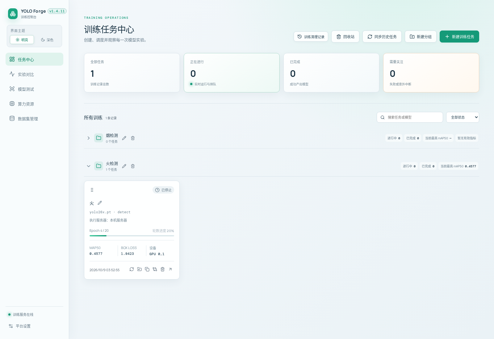
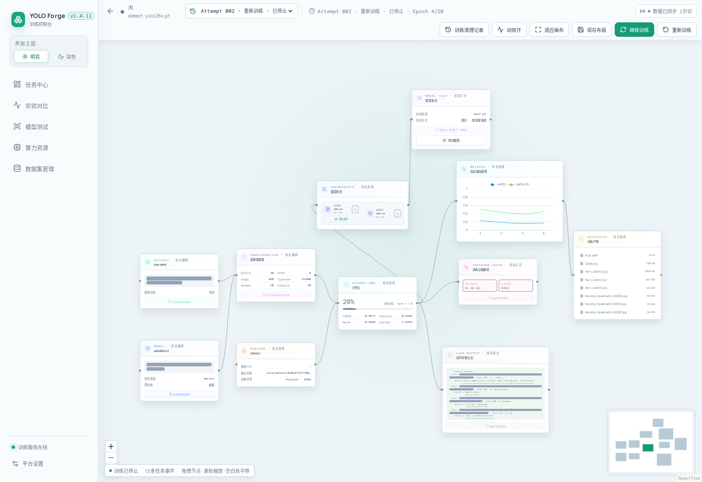
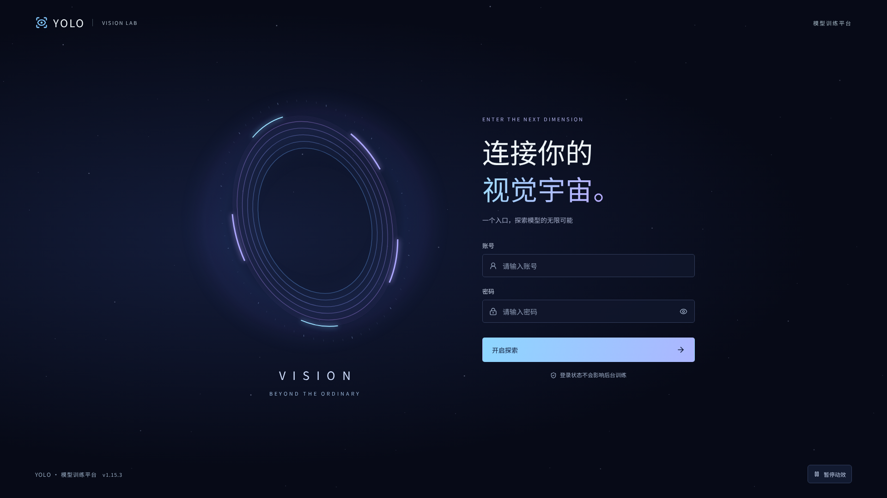
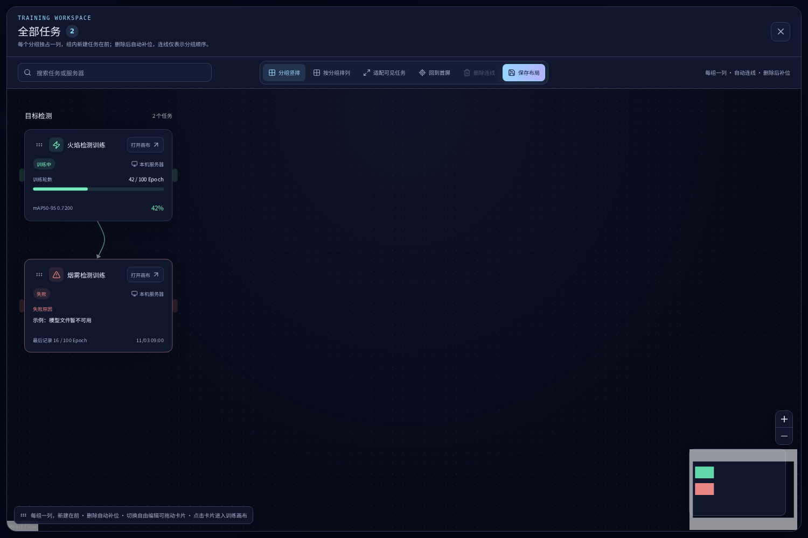
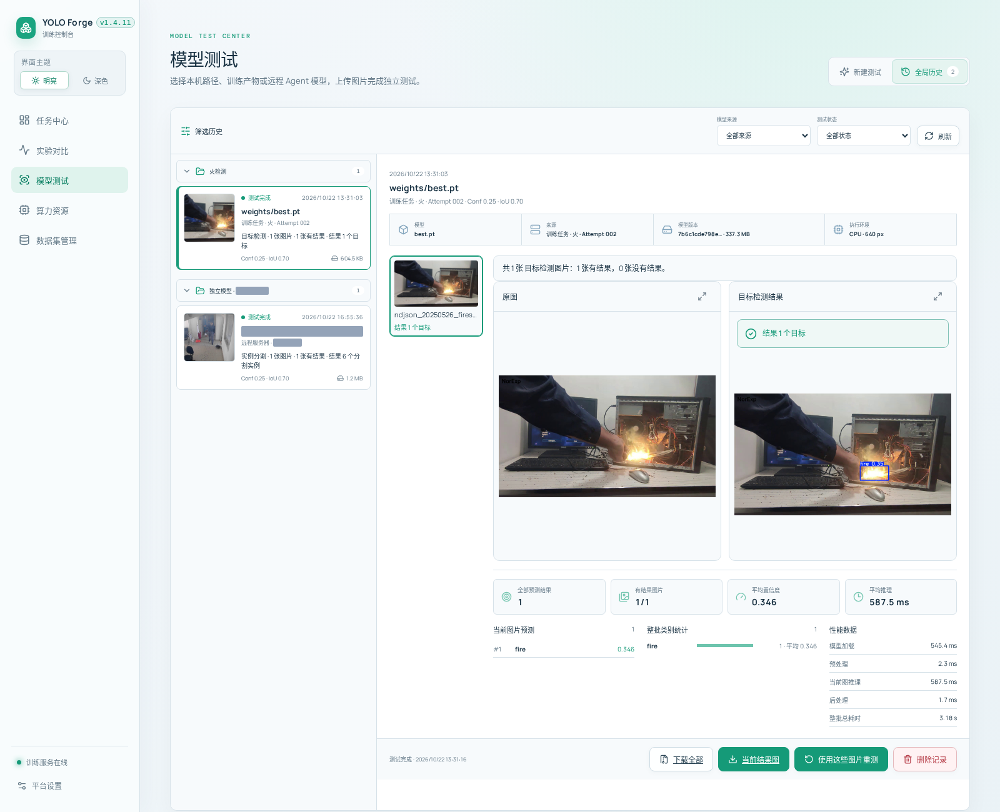
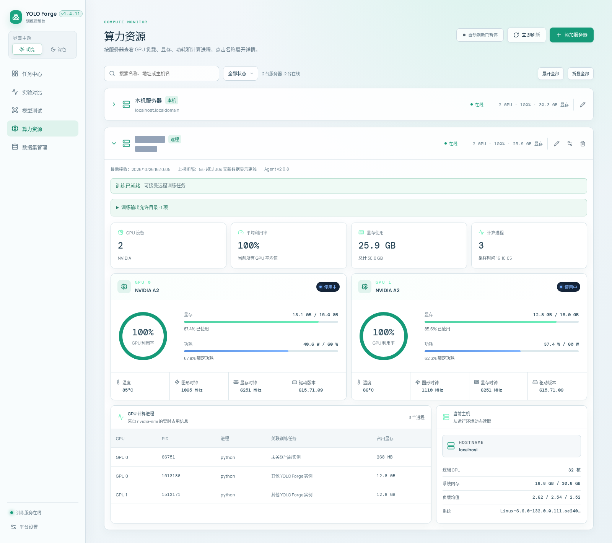
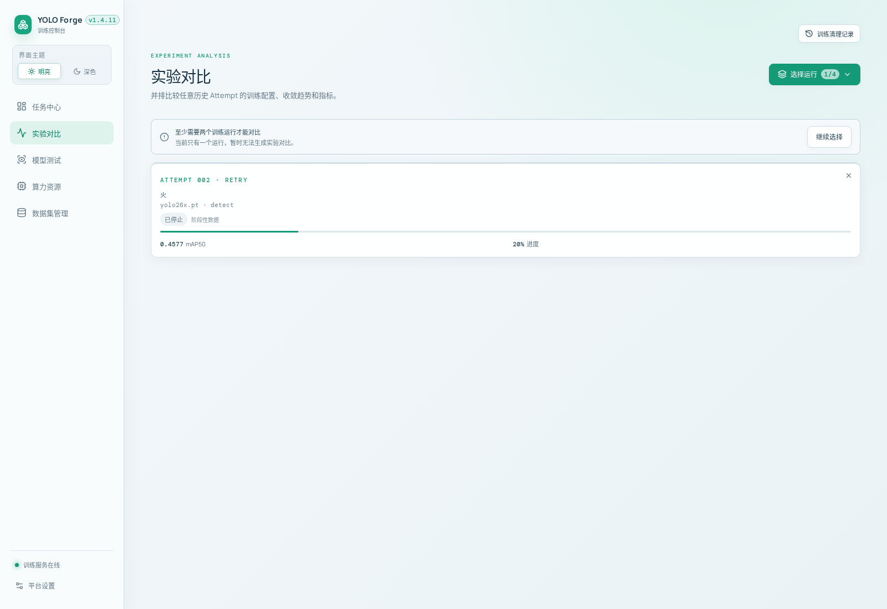
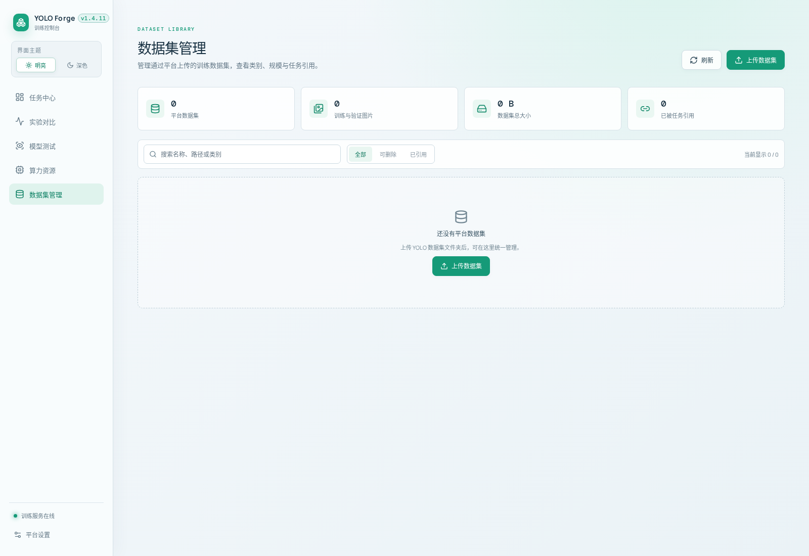

# YOLO Forge · YOLO 模型训练平台

**把训练任务、指标曲线、模型测试与多服务器算力放在一个工作空间。**

基于 Ultralytics 的可视化训练平台，通过浏览器管理本机与远程训练，用画布查看运行过程，保留每次实验的参数、日志和权重。

[界面预览](#界面预览) · [主要功能](#主要功能) · [快速开始](#快速开始) · [文档导航](#文档导航) · [更新日志](CHANGELOG.md)

## 界面预览

### 任务中心 · 从分组到每一次训练

按实验分组整理任务，搜索与筛选状态，查看训练进度、指标和执行节点。

[](docs/screenshots/v1.4.11-task-center.png)

### 训练画布 · 配置、曲线和产物一起看

每条任务有独立画布，按 Attempt 切换历史运行，查看参数、指标、日志与权重，并进入模型测试。

[](docs/screenshots/v1.4.11-training-canvas.png)

以上为 **v1.4.11 明亮主题实机截图（2026-10-26）**，已遮挡服务器地址和部署路径；页面细节以所用版本为准。点击图片可查看原图。下方可展开其他页面与新版外观。

<details>
<summary><strong>登录与全息深蓝外观 · 查看预览</strong></summary>

登录页采用左侧动态全息光环、右侧账号表单。首次部署由维护者设置管理员；登录后可在“平台设置 → 账号与安全”修改密码。下图为 v1.15.3 的登录页截图（2026-11-03），动态效果以实际运行页面为准。

[](docs/screenshots/v1.15.3-login.png)

v1.15.4 新增登录页同款“全息深蓝”外观。下面展示任务总览的分组竖排、弧线与点阵画布；使用隔离的示例数据渲染（2026-11-03），状态、进度和指标不代表实际训练结果。

[](docs/screenshots/v1.15.4-task-overview.png)

</details>

<details>
<summary><strong>模型测试 · 原图与检测结果对照</strong></summary>

选择本机模型、训练产物或远程模型，上传图片并设置阈值。支持只测试选中图片、增量处理与全部重测，历史保存原图、结果、参数与下载文件。

[](docs/screenshots/v1.4.11-model-test-history.png)

截图来自 v1.4.11 已有检测历史（2026-10-26），不是本次文档更新时新执行的推理。

</details>

<details>
<summary><strong>算力资源 · 本机与远程 GPU</strong></summary>

按服务器查看 GPU 利用率、显存、功耗、温度、进程及 Agent 状态。Agent 主动连接中心，无需在平台保存 SSH 密码。

[](docs/screenshots/v1.4.11-compute-resources.png)

截图来自 v1.4.11 开发环境（2026-10-26）；负载与在线状态仅代表拍摄时刻。

</details>

<details>
<summary><strong>实验对比与数据集管理 · 查看页面</strong></summary>

实验对比可选择不同任务或同一任务的多个 Attempt，对照指标曲线与参数。数据集管理支持上传、登记、扫描、本机/远程保存位置及跨节点复制迁移。

[](docs/screenshots/v1.4.11-experiment-compare.png)

[](docs/screenshots/v1.4.11-datasets.png)

两图为 v1.4.11 的引导状态（2026-10-26）：当时只有一个可选 Attempt，因此尚未显示多运行曲线；数据集页只列平台登记的数据集，外部 YAML 不自动入列。

</details>

完整截图来源、版本与尺寸见[截图说明](docs/screenshots/README.md)。

## 主要功能

| 模块 | 可以做什么 |
| --- | --- |
| 任务中心 | 分组、搜索、创建、克隆、排队、停止、续训与重新训练；回收站及清理记录 |
| 任务总览 | 点阵无限画布、分组竖排、自由移动、弧线关联、保存布局与视口 |
| 训练画布 | 按 Attempt 查看配置快照、训练进度、指标曲线、日志和权重 |
| 实验对比 | 对比多次训练的指标与参数，区分完整结果、阶段数据及可比条件 |
| 模型测试 | 五类 YOLO 任务、多图与单图测试、增量处理、持久历史及结果下载 |
| 数据集管理 | YOLO 检测数据集上传/登记、扫描、完整校验、跨节点复制迁移与引用保护 |
| 算力资源 | 本机/远程 GPU 监控，按节点与 GPU 预约安排并行训练 |
| 平台设置 | 外观、任务中心、实验、数据集、服务状态、存储路径与账号安全 |

**技术栈：** React 19 · TypeScript · React Flow · ECharts · FastAPI · SQLAlchemy · SQLite · PyTorch / Ultralytics。

中心通过各执行节点的 `yolo` CLI 启动训练，远程输出保存在对应服务器；并行调度依据 GPU 资源预约，不是显存余量自动调度。模型测试目前在中心 CPU 执行，远程模型先通过 Agent 获取。配置和版本能力要求见[安装与使用](docs/getting-started.md)及 [Agent 说明](web/agent/README.md)。

## 快速开始

建议 Linux、Python 3.11+、Node.js 20。先根据服务器安装适用的 [PyTorch / CUDA 环境](https://pytorch.org/get-started/locally/)，再执行：

```bash
git clone https://github.com/scsg666g/yolo-xlpt.git
cd yolo-xlpt

python -m pip install -e ./ultralytics
python -m pip install -e './web/backend[dev]'

cd web/frontend
npm ci
npm run build

cd ../backend
python -m uvicorn app.main:app --host 0.0.0.0 --port 18088 --workers 1
```

浏览器访问 `http://<服务器地址>:18088`。首次启动时，在另一个终端进入同一 checkout 的 `web/backend`，使用相同服务账户、Python 环境及目录配置执行：

```bash
python -m app.auth setup-code
```

在网页输入一次性校验码，设置管理员账号与密码。项目不提供默认密码；后续在“平台设置 → 账号与安全”修改密码。详见[账号与安全](web/README.md#账号与安全)。

保持 **`--workers 1`**，同一数据库及运行目录仅由一个后端实例管理。默认目录从项目位置推导，部署时可通过[环境变量](web/.env.example)调整；不要覆盖已有配置或运行数据。正式部署、路径迁移及备份按下方文档操作。

## 文档导航

| 想了解什么 | 从这里开始 |
| --- | --- |
| 环境准备、完整安装、路径配置与基本流程 | [安装与使用](docs/getting-started.md) |
| 账号、任务操作、模型测试、上传和日志 | [Web 平台操作手册](web/README.md) |
| 远程节点接入、配置与 Agent 升级 | [远程 Agent 说明](web/agent/README.md) |
| 数据集保存位置、登记、迁移与删除边界 | [数据集存储说明](docs/dataset-storage.md) |
| systemd、双实例、备份恢复与故障排查 | [部署与维护](web/deploy/README.md) |
| 架构、代码职责与维护建议 | [项目分析](docs/project-analysis.md) |
| 历史版本功能与修复记录 | [更新日志](CHANGELOG.md) |
| 图片版本、来源与更新约定 | [截图说明](docs/screenshots/README.md) |

## 许可证

仓库内 Ultralytics 组件的使用条件以其[框架说明](ultralytics/README.md)和[许可证](ultralytics/LICENSE)为准。
