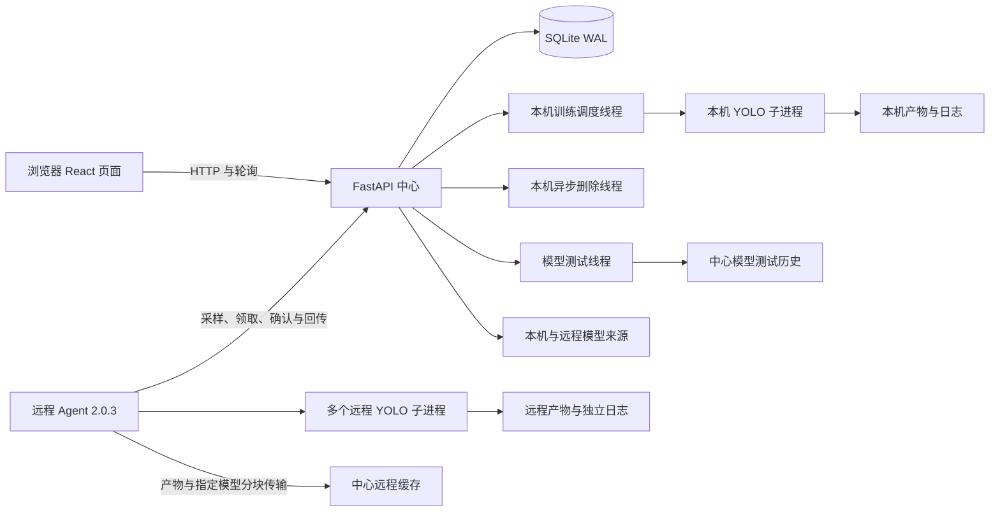

# YOLO Forge 项目分析与维护建议

核查日期：**2026-10-21**。代码基线为当前开发版工作区；平台版本为 **1.4.0**，配套远程 Agent 为 **2.0.3**。

本文记录当前实现、运行边界和后续优化顺序。安装入口见 [项目首页](../README.md)，页面操作见 [Web 说明](../web/README.md)，远程执行见 [Agent 说明](../web/agent/README.md)，服务与备份见 [部署说明](../web/deploy/README.md)。

## 当前结论

平台已具备本机与远程训练闭环，包括任务及 Attempt 历史、参数编辑与校验、检测数据集上传管理、训练过程解析、任意历史 Attempt 对比、模型图片测试、远程产物传输以及本机和远程异步清理。1.4.0 将图片模型测试从训练画布扩展为独立侧栏页，可不创建训练任务而直接测试本机或远程 `.pt`，同时保留训练 Artifact 入口和全局持久历史。

1.3.0 为本机和远程训练增加持久资源预约：同一执行节点上的同卡任务互斥，不同卡可以并行，多卡任务原子预约整组设备；CPU 和 MPS 不占 CUDA GPU 预约。远程训练最低 Agent 版本仍为 1.8.0。官方 Agent 从 2.0.0 开始上报 `training.gpu_parallelism=true`，中心实际以该能力字段为并行开关；未上报字段的官方旧 Agent 保持整机串行，版本号本身不会代替能力上报。完整远程进程关联仍需要 Agent 1.9.0 或以上，关联依据不足时页面显示未知或歧义，不根据同号 PID 推断任务。

发布验证应在当前 checkout 上重新执行，不沿用 1.0.0 / 1.7.0 时的用例数量：

| 检查 | 命令或范围 | 边界 |
| --- | --- | --- |
| 后端测试 | `python -m pytest -q web/backend/tests` | 从仓库根目录只收集平台后端用例，避免同时收集上游 Ultralytics 测试 |
| 前端静态检查 | `npm run lint` | 不等于真实浏览器交互验收 |
| 前端生产构建 | `npm run build` | 验证 TypeScript 和 Vite 构建，不验证已运行服务是否加载新产物 |
| Agent 检查 | 三份脚本语法检查和版本输出 | 核对源代码与两份部署包一致；各服务器私有配置与真实路径须在目标服务器执行 `--check-config` |

## 架构和运行边界

中心 API、训练调度器、本机删除线程和模型测试线程位于同一进程。Uvicorn 必须保持一个 worker，同一数据库和状态目录也只能由一个后端实例管理。若要扩展为多 API 实例，需先分离调度器、文件操作和进程所有权，并替换不适合多实例协调的 SQLite 及内存状态。

远程服务器主动连接中心，不依赖 SSH。每个 Agent Token 只允许访问对应节点的上报、训练和文件操作接口；平台管理页面和普通管理 API 仍没有用户登录认证。

API 接受 `detect`、`segment`、`classify`、`pose`、`obb`，但数据集上传、模型图片测试、训练过程解析和主要比较指标仍以 `detect` 为主。任务类型可选择不代表五类任务已获得同等程度的业务验收。

## 1.4.0 独立模型测试中心

前端新增 `/model-tests` 一级页面，与训练画布内已有检测入口共用多图上传、Conf / IoU、原图与结果对照、统计、下载、重测和删除逻辑。独立页按本机路径、训练 Artifact 和远程路径三种来源选择权重，全局历史将绑定训练任务的旧记录与不绑定任务的新记录统一展示。原画布接口和历史数据保持兼容。

后端新增 `model_assets` 来源表，`model_tests.task_id` 可空并可通过 `model_asset_id` 绑定独立模型。每条测试仍固定建立时的权重大小与 SHA-256，避免同路径文件替换后静默改变本次推理或历史重测的语义。数据库启动迁移保留旧的任务绑定记录；独立检测文件使用 `model-test-history/_standalone/` 范围。

本机指定模型只能位于 `PLATFORM_MODEL_TEST_ROOTS` 范围，默认是当前 checkout 的相对 `pt/`。这使开发版、使用版和其他 Git checkout 自然解析到各自根目录，不需要写死绝对路径。登记时对真实路径、扩展名、普通文件、符号链接、大小与 SHA-256 做服务端校验；登记和删除测试记录不会删除用户的原始 `.pt` 文件。

远程指定模型要求 Agent 2.0.3 上报 `training.model_test_roots`。中心只对绝对 POSIX 路径做规范化和上报根目录范围检查，不使用中心文件系统解析远程路径。Agent 再在远程主机拒绝范围外文件、符号链接和非普通 `.pt`，通过 `fetch_model` 分块回传固定大小、修改时间和最终 SHA-256。中心以数据库 `finalizing` 状态跨 worker 原子认领最终提交，完整哈希期间持续续租，并在发布前再次校验租约；重复最终分块会幂等地收敛，失去心跳的最终提交仍可按租约规则恢复。Agent 对训练产物 `fetch` 和独立模型 `fetch_model` 的最终分块统一使用 `model_transfer_finalize_timeout_seconds`，普通分块仍保持 20 秒超时。中心在校验完整文件后原子固定缓存，然后与本机模型使用同一 CPU 推理队列。已完成历史由中心持久化，不依赖 Agent 在线；已完整缓存的模型也可在节点暂时离线时继续新建检测。

这个功能扩大了可从管理 API 请求读取的模型范围和中心缓存占用。当前管理入口仍没有内置用户认证，因此继续要求可信内网或带认证的 HTTPS 网关，并应把 `PLATFORM_MODEL_TEST_ROOTS` 与 Agent `model_test_roots` 都限制为必要的最小目录。

## 1.3.0 按 GPU 并行调度与远程多 Run 管理

中心为活动 Run 建立持久资源预约，并把领取、整组预约和 `queued -> starting` 状态迁移放在同一事务中。同一节点的资源键冲突时领取整体回滚，不会留下部分多卡预约；Run 进入 `completed`、`failed`、`stopped` 或 `interrupted` 后释放预约。CPU 和 MPS 不申请 CUDA GPU 资源：本机 CPU 使用每个 Run 独立的资源键，可与其他 CPU/GPU Run 并行；本机 MPS 使用节点内共享的 MPS 键，MPS Run 彼此互斥但可与 CUDA Run 并行；远程 CPU/MPS Run 使用节点级独占预约。不同机器上的 GPU `0` 不会互相阻塞。

GPU 资源优先使用稳定 UUID 标识，避免设备编号变化后把预约关联到另一张物理卡。本机设备清单能确认 GPU 编号但没有 UUID 时，使用节点内编号作为预约键；远程并行严格要求编号和 UUID 均可验证，缺少设备或 UUID 时任务继续排队，Agent 启动前发现映射变化也会拒绝启动。中心预约只协调平台受管 Run；平台外进程不会因利用率或 PID 相似而自动写入预约，真实部署仍需避免其他程序绕过平台争用显卡。

服务启动时会校准预约与活动 Run。API 重启不会直接释放远程活动预约；它们保留到远程 Agent 更新 Run 状态。对本机任务，平台按 PID、命令签名和进程启动时间重新接管匹配进程并补充预约；无法接管的进程标记为中断并释放预约。已进入终态的遗留预约会被回收。这使 Web/API 生命周期不再等同于 GPU 预约生命周期，同时继续使用完整运行身份避免 PID 复用造成误接管。

远程中心以 Agent 上报的 `training.gpu_parallelism` 能力字段为实际开关。官方 Agent 从 2.0.0 开始上报 `true`；中心验证请求编号和设备 UUID 后，可向同一节点并行派发 GPU 集合不重叠的 Run。官方 Agent 1.8.x、1.9.x 和任何未上报字段的节点继续按整台服务器一次一个 Run 调度。这个默认值是兼容边界，避免新版中心同时派发多个任务给只实现单活动状态的旧 Agent；当前实现不单独把版本字符串作为并行门禁。

Agent 2.0.0 使用单进程协调器管理多个 Run 线程，每个 Run 有独立活动状态、停止事件、指标日志同步和恢复判断。重启后会枚举 `.training-state/active/` 中的所有记录，逐项核对 PID、启动时间、命令签名和 boot ID，只恢复身份完整匹配的进程。正常退出 Agent 时会停止并等待所有受管训练分别收尾。

为覆盖同一宿主机上的多个 Agent，中心下发有效 `gpu_assignment` 后，2.0.0 按 `nvidia-smi` 返回的稳定 GPU UUID 获取用户状态目录中的 `flock`。多卡任务按 UUID 排序后整组加锁，避免交叉获取导致死锁；Agent 无法读取稳定 UUID 或检测到编号映射变化时，会拒绝启动该 Run，不退回到不稳定编号锁。此时传统 workspace 锁和整套层级输出根锁均改为共享持有，使不同 GPU 的新版 Run 可以共享配置输出根，同时继续与旧协议任务和文件删除使用的独占锁协调。旧中心未下发 GPU 分配时仍走传统独占路径。GPU 锁、层级输出根锁和 workspace owner 登记要求同机 Agent 使用同一专用系统账户；不同账户不能共享这套主机级保护。

本次新增数据库表并由启动迁移自动创建，升级前仍应使用 SQLite Backup API 生成一致备份。自动化测试覆盖领取冲突、异卡并行、多卡整体回滚、旧 Agent 串行和预约释放；真实 GPU、DDP、Agent 崩溃以及多中心连接同一宿主机仍需在目标环境验收。

## 1.2.1 未完成 Attempt 诊断与对比口径

[实验对比页](../web/frontend/src/components/ExperimentCompare.tsx)默认收起失败、停止和中断记录，并提供开关展开；已有选择不会因筛选而隐藏或自动替换。每条运行可按需读取错误摘要、最近事件、日志尾部、指标和产物清单，详情读取失败时保留可读取的其他部分。产物摘要优先列出 `best.pt` / `last.pt`，文件较多时可展开完整清单。

阶段指标和训练曲线仍可用于观察中断前的收敛情况，但只有 `status=completed` 的 Attempt 才参与最优排名。完成判据使用运行状态，而非达到计划 Epoch 数，因此正常 EarlyStopping 的完成训练仍可参与排名。差值只有在当前运行与基准运行都已完成时才标成改善或下降；阶段值只作为参考展示。

续训 Attempt 在写入自己的指标前可能继承上个 Attempt 的进度和最新指标字段。对比表优先读取该 Attempt 自己的指标序列，续训尚无新指标时不把继承值当作本次结果。权重列表和 `best.pt` 来源只代表产物元数据已登记，不能证明文件仍可读取或模型可加载；要验证可用性仍需通过模型测试。

此次只调整平台前端、版本信息和说明文档，没有修改 Agent、数据库协议或后端接口；配套 Agent 版本保持 **1.9.0**。

## 1.2.0 GPU 进程与训练 Run 关联

本机训练启动时注入存储在平台数据目录中的实例 ID、节点 ID、任务 ID 和 Run ID；这些非敏感标识由 DDP 子进程继承。实例 ID 首次创建后保存在配置数据根目录，路径由 `PLATFORM_DATA_ROOT` 决定，不依赖固定服务器目录。

本机后端读取 GPU 进程的 Linux `/proc` 环境和父进程链；远程 Agent 1.9.0 上报相同的归属线索，并可用其受管活动 Run 根 PID 作为回退。中心只对照当前实例、节点、活动 Run 和任务记录后才返回任务名称。冲突标为歧义，其他实例不泄露任务名称，已结束 Run 标为孤儿，旧快照标为过期。Agent 低于 1.9.0 时仍能上报算力和执行兼容训练，但远程任务关联显示为不可用。

这次没有新增数据库列，因此不需要迁移。远程上报字段为可选值；Linux `/proc` 权限不足、进程已退出、父进程链不完整或历史进程未带运行标识时，系统保留“归属无法确认”，避免因 PID 复用或跨实例同号 PID 错误关联。

## 1.1.1 资源路径编辑优化

[资源编辑弹窗](../web/frontend/src/components/EditResourceModal.tsx)只在每次打开时初始化路径，将后续输入保留为本次草稿；任务对象每 3 秒刷新时不再重置。弹窗明确未保存状态，未变更时禁用保存，失败时保留输入，关闭未保存内容前要求确认。

[训练画布](../web/frontend/src/components/TaskCanvas.tsx)统一协调资源保存：提交前暂停普通轮询并取消旧请求，保存后主动加载权威状态。数据集和模型节点在当前配置与所选 Attempt 不同时，以任务新路径为主值，标记“重新训练使用”，并另行显示当前 Attempt 的训练时快照。查看旧 Attempt 时仍只展示历史快照且不允许编辑。

[资源更新模型](../web/backend/app/schemas.py)统一去除路径首尾空白，拒绝空路径和未知字段。保存仍只更新 `TrainingTask`，不改写已存在的 `TrainingRun`；基础模型或数据集变化时拒绝沿用旧 Attempt 断点续训，重新训练创建新 Attempt 时才复制当前路径。远程路径不限定为特定服务器目录，文件、权限和允许范围继续由 Agent 检查。

## 1.1.0 已实现的主要优化

### 版本与运行路径来源统一

仓库根目录 `VERSION` 是平台版本的单一源。Vite 构建将它注入左上角品牌；FastAPI 版本和 `/api/health` 也读取它，`PLATFORM_VERSION` 可在特殊打包场景显式覆盖，安装包元数据是源码版本文件不可用时的回退。

本机 `YOLO_BIN` 可显式配置为命令或路径；未设置时先查找当前 Python 环境的 `yolo`，再查找 `PATH`。项目、数据、运行、日志和 SQLite 相对路径从当前 checkout 推导，不依赖启动终端的当前目录。

### 本机调度启动与停止竞争收紧

[本机调度器](../web/backend/app/services.py)只统计 `execution_node_id` 为空的活动任务。远程 GPU `0` 不会阻塞申请本机 GPU `0` 的任务；本机相同或重叠 GPU 仍会排队，本机不同 GPU 可以并行。

队列任务通过带原状态条件的数据库更新原子地进入 `starting`。调度器在 `Popen` 之前持久化运行命令和启动意图，再处理同时到达的停止请求；子进程已创建但数据库写入失败时也有明确的恢复路径。这些保护用于避免两个调度回合或停止竞争重复启动同一 Attempt。

调度循环异常现在会记入服务日志，并在健康接口暴露当前错误、最近错误及时间。当前一轮失败时 `scheduler=error`，下一轮成功后回到 `running`，但保留最近错误供排查。

### 本机文件删除和历史导入更稳健

本机永久删除只接受明确位于运行或运行时根目录下的任务目录。验证时保留末端符号链接本身，遇到顶层或目录树内的符号链接只移除链接，不跟随到指向的外部目录。模型和数据输入路径从不作为任务删除目标。

产物同步会移除已不存在的本地产物记录，避免数据库中继续展示失效文件。历史扫描时的单个损坏 `args.yaml` 只记录警告并跳过该目录，不再中断其他可用历史的导入。

### 参数和续训语义统一

创建和编辑任务会拒绝空白名称、空白优化器和重复 GPU 编号。动态参数根据参数目录校验类型、有限数值和有效范围；非数、无穷值和超界值在进入命令前就被拒绝。

本机与远程续训都使用上一 Attempt 的检查点语义：数据集必须一致，目标总轮数不能与断点状态冲突。需要更换数据集或重置训练计划时应使用“重新训练”。

### Agent 1.8.0 增加训练门禁和共享 workspace 协调

[远程节点服务](../web/backend/app/compute_nodes.py)将最低 Agent 版本统一为 1.8.0。创建、启动、续训、重新训练和领取阶段都检查节点已启用、版本达标、中心接收时间 `last_seen_at` 未过期，以及最近能力上报中 `training.ready=true`。远程时钟落后不会把刚收到的上报误判为离线；Agent 发现自身训练环境未就绪时也会暂停领取新任务。

Agent 1.8.x 在当前系统账户的私有状态目录中为输出根建立独占层级意向锁。相同或父子输出根互斥，不相交的兄弟根可并行；保护不依赖两份配置的 `training_lock_file` 字符串完全相同。若两个 Agent 另外共用同一个传统锁文件，该锁仍会将不相交的训练串行。这是 1.8.x / 1.9.x 及当前兼容任务的历史行为；2.0.0 在收到有效 GPU 分配后改用共享 workspace 和输出根锁，并由 GPU UUID 锁承担同卡互斥。workspace owner 使用稳定 `node_id` 生成，不依赖配置文件路径或进程 PID。共享输出根内存在其他存活 Agent 时，永久删除被拒绝并保留可重试状态。由于该状态目录权限为 `0700`，同机多 Agent 必须使用同一专用系统账户才能共享完整保护；不同账户共享传统锁文件无法共享删除 owner 登记。

`yolo_bin` 默认为 `PATH` 中的 `yolo`，`training_cwd` 默认为 Agent 配置文件所在目录，不再预设某台服务器的项目绝对路径。各机器只需在真实有差异时显式覆盖。

### Agent 1.8.1 补充输出目录契约和可迁移配置

配置文件以 `_comments` 保存中文字段说明，保持标准 JSON。`training_cwd` 相对配置文件目录；允许目录、输出目录、锁文件和带 `/` 的相对 YOLO 路径基于该工作目录解析。单独的 `yolo` 仍使用 `PATH`，原有绝对路径仍兼容。`--check-config` 显示解析后的目录，不输出 Token。

Agent 在 `training.output_roots` 上报允许的输出范围。新版开发页面据此提示可选目录，中心在接受训练前检查路径范围；实际文件、权限、符号链接和删除 owner 保护仍由 Agent 执行。最低版本维持 1.8.0，未上报新字段的节点兼容原有流程；旧中心连接 1.8.1 不会自动获得新版前端和服务端逻辑。

供复制的开发版和使用版 Agent 包分别配置 `runs` 与 `ultralytics/runs`，这是当前远程目录布局的部署选择，不是程序固定路径。新中心下发有效 GPU 分配时，Agent 2.0.0 以共享方式持有传统 workspace 和输出根锁，并使用 GPU UUID 锁提供同卡互斥；旧中心仍使用传统独占路径。独立输出根继续隔离产物归属。历史任务路径不自动迁移，共享旧根的删除 owner 保护不绕过。开发项目和两份待复制 Agent 包可以同时升级，但不直接同步使用版项目或覆盖两份包各自的节点配置。

### Agent 恢复和远程进程关联更准确

Agent 将每个活动运行以私有权限原子写入 `.training-state/active/`，记录 PID、进程启动时钟、命令哈希、boot ID 和 GPU 分配。Agent 2.0.0 重启后逐项接管身份完全匹配且仍可达的训练进程，不会仅凭 PID 接管，也不会因发现多个有效记录而整体放弃恢复。接管进程自然结束而无法获取原退出码时，Agent 结合已完成 Epoch、非空 `best.pt` / `last.pt` 和日志完成标记判定结果：证据足够则标记 `completed`，证据不足则标记 `interrupted` 并保留产物供核对。

算力页现在使用运行标识或经过验证的启动进程祖先，并对照 `execution_node_id`、Run 状态和任务记录；PID 仅用于查询进程，不作为单独的任务身份。版本低于 1.9.0 的远程 Agent 不提供新归属线索。

### 实验对比与界面交互完善

[实验对比页](../web/frontend/src/components/ExperimentCompare.tsx)现在列出每个任务的全部历史 Attempt，支持同一任务的不同运行直接对比。选择状态和 URL 使用运行 ID，旧的任务 ID 链接会尽量转换到当前或最近 Attempt。指标列、参数列和已选卡片与实际已选运行数量一致，超出可见宽度时使用横向滚动。

任务中心的分组是中心数据库实体，任务仅保存可空的 `group_id`，不改变训练目录或远程 Agent 协议。对“未分组”命名时，平台在一个事务内创建分组并关联当前任务；删除分组只清空关联并保留任务及其全部数据。标题旁的铅笔和删除按钮分别提供直接入口，删除仍需二次确认。

任务中心使用自适应卡片列，算力页根据可用宽度排列 GPU 卡片并将进程表独立横向滚动，训练画布和对比页也补充了宽屏与窄屏规则。核心弹窗共用焦点管理，支持 Esc 关闭、Tab 焦点限定和关闭后恢复到触发控件；窗口缩放时工具栏和正文保持可读。

## 当前问题与优化优先级

### P0：管理入口没有认证

普通任务、数据集上传、模型测试、节点管理、Token 轮换和永久删除接口没有用户身份验证。单人可信内网可继续使用；开放给多人、其他网段或公网前，应在反向代理增加 HTTPS 和身份认证。Agent Token 只保护节点接口，不能代替网页管理员认证。

### P1：日志和指标读取仍会随数据增长变重

训练画布定期加载任务、运行、指标、产物、事件和日志。本机日志接口仍会读取完整文件后截取尾部，指标同步也会重新读取 `results.csv`。远程中心只保留日志尾部，页面的复制与下载不是完整远程日志。

后续应使用文件偏移量增量读取日志和指标，为完整本机日志提供流式下载，并对远程完整日志增加专用传输或保持明确的“尾部快照”语义。

### P1：存储缺少平台级统一配额与告警

模型测试历史已有全局与单任务配额、最低剩余空间和持久预留，但权重、训练图片、日志、远程产物缓存、过程解析、数据集发布和数据库备份仍分别管理。建议将现有配额机制扩展到训练启动、数据集发布和远程文件准备，并在页面展示容量和阈值告警。

### P1：数据库快照不能替代完整文件备份

[数据库自动迁移](../web/backend/app/database.py)和[备份脚本](../web/deploy/backup_database.py)均使用 SQLite Backup API，会包含 WAL 中已提交的内容并执行完整性检查。自动备份只在实际执行架构迁移时生成；升级前仍应显式运行备份脚本，作为可预期的回滚点。

模型测试历史由 SQLite 索引与 `model-test-history/` 文件共同组成，两者必须在没有活动写入时作为同一备份集保存和恢复。Agent `.training-state/` 也需在远程主机单独保留。

### P2：前端仍同时维护轮询和未使用的 SSE

后端已提供 `/api/stream` SSE，任务中心仍每 3 秒轮询 `/api/tasks`，实验对比每 5 秒重新请求任务和运行列表。可选择接入 SSE 并保留断线轮询回退，或删除未使用的流接口；对比页也应在页面隐藏或入选运行全部结束时降低刷新频率。

### P2：前端关键流程缺少端到端测试

后端对竞争、门禁、恢复和路径边界已有针对性测试，前端仍主要依赖 lint 与构建。建议增加少量真实浏览器端到端测试，覆盖创建与停止、回收站、任意历史 Attempt 对比、远程就绪门禁、模型测试以及弹窗键盘焦点。

## 推荐实施顺序

| 顺序 | 工作 | 验收重点 |
| --- | --- | --- |
| 1 | 增量日志、指标与完整日志导出 | 大日志和长训练下请求耗时稳定，本机与远程导出语义明确 |
| 2 | 平台级容量统计、预检与回收策略 | 训练、数据集和缓存在磁盘耗尽前给出可操作提示 |
| 3 | 轮询收敛与端到端测试 | 隐藏页面不产生无效请求，核心交互和焦点行为可回归 |
| 4 | 多任务类型的功能对齐验收 | `segment` / `classify` / `pose` / `obb` 的数据、指标、测试和对比语义明确 |

## 验证范围说明

自动化测试、lint、生产构建、脚本语法检查和离线配置检查只能证明已覆盖的代码路径。它们不代替真实模型、数据、CUDA / DDP、Agent 崩溃与网络故障、多机时钟偏差、浏览器兼容性、并发压力、完整迁移回滚和备份恢复演练。

发布时应备份各远程 Agent 的脚本、真实配置并保留 `.training-state/`。升级当前 Agent 2.0.3 时必须保留各节点身份、Token 和已有路径；只在 `--check-config` 发现实际目录问题时按目标服务器布局调整，不能用另一套环境的配置覆盖。确认目录存在且可写后执行 `--version`、`--check-config` 和 `--once`，并核对 `model_test_roots` 与 `model_transfer_finalize_timeout_seconds` 的实际解析值。平台 1.4.0 后端代码和数据库迁移需要重启目标服务才会生效；前端代码变更需要重新生成生产构建。远程异卡并行的能力起点仍是 Agent 2.0.0：只有在中心支持预约、Agent 重启并成功上报 `training.gpu_parallelism=true`、设备 UUID 可验证且任务收到有效 `gpu_assignment` 后才会启用；独立远程模型测试另外要求 Agent 2.0.3。
