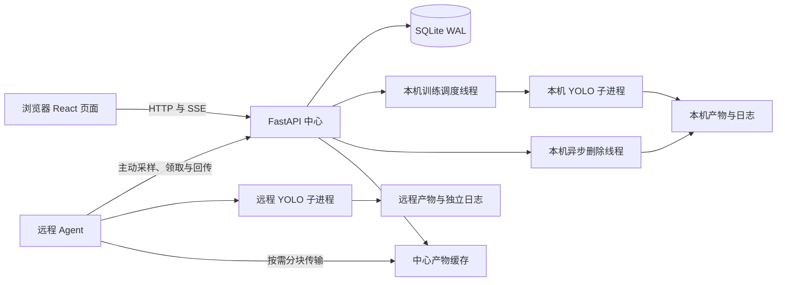

# YOLO Forge 项目分析与维护建议

核查日期：**2026-10-14**。代码基线：`715e636`。中心 API 与前端包版本均为 `0.1.0`，随仓库提供的 Agent 为 `1.4.0`。本文记录当前实现和本次验证，不承诺后续版本仍有相同行为；文档更新没有修复下列代码问题。

本次更新范围是平台自有的 4 份 README 和本分析文档，保留 `ultralytics/` 内上游 Markdown。安装入口见 [项目首页](../README.md)，页面与任务规则见 [Web 说明](../web/README.md)，远程执行见 [Agent 说明](../web/agent/README.md)，服务与备份见 [部署说明](../web/deploy/README.md)。

## 应用定位与成熟度

这是一个基于 Ultralytics 的浏览器模型训练管理平台：中心后端调用 YOLO CLI，前端管理任务和运行历史、展示曲线与训练产物，独立 Agent 提供远程监控和可选训练。React Flow 用于展示和编辑训练画布，实际执行流程由后端及 Agent 的任务状态控制。

已有可用的任务、Attempt 历史、检测数据集上传、参数编辑、实验对比、远程文件传输和异步清理能力，适合由管理员在可信网络内管理训练。当前仍存在影响日常使用的日志导出缺陷、调度隔离缺陷和远程领取恢复缺口，尚不能仅凭单元测试与页面外观认定已完成正式使用验收。

API 接受 `detect`、`segment`、`classify`、`pose`、`obb`，但上传校验是检测框标签格式，资源选择主要面向 YAML，实验对比主要使用检测框指标。其他类型需要准备合适输入并单独验收，不能把 API 枚举当成五种完整业务流程已验证。

## 系统架构



中心 API、训练调度器和本机删除线程处于同一进程。必须使用单个 Uvicorn worker，且同一数据库和运行目录只能由一个后端实例管理。多实例不能直接共享 SQLite 和输出目录；若要扩容，需先分离调度、文件操作和进程所有权，并设计协调机制。

远程服务器主动请求中心，没有 SSH 执行通道，也不会因为页面填写 IP 就自动接入。Agent Token 绑定对应节点，中心数据库存哈希；管理页面和管理 API 尚无内置登录认证，Agent Token 不提供管理员认证。

### 代码职责

| 入口或模块 | 主要职责 |
| --- | --- |
| [frontend/src/App.tsx](../web/frontend/src/App.tsx) | 页面路由与界面入口 |
| [Dashboard.tsx](../web/frontend/src/components/Dashboard.tsx) | 任务中心、操作入口和回收站 |
| [TaskCanvas.tsx](../web/frontend/src/components/TaskCanvas.tsx) | Attempt 选择、训练画布及轮询 |
| [EditParametersModal.tsx](../web/frontend/src/components/EditParametersModal.tsx) | 参数编辑、导入与识别结果 |
| [LogViewerModal.tsx](../web/frontend/src/components/LogViewerModal.tsx) | 日志搜索、滚动、复制和 Blob 导出 |
| [ExperimentCompare.tsx](../web/frontend/src/components/ExperimentCompare.tsx) | 按运行对比配置与指标 |
| [ComputeResources.tsx](../web/frontend/src/components/ComputeResources.tsx) | 本机及远程算力展示、节点操作 |
| [main.py](../web/backend/app/main.py) | API、生命周期、前端静态文件与健康检查 |
| [services.py](../web/backend/app/services.py) | 本机训练进程、指标与产物同步、历史导入 |
| [models.py](../web/backend/app/models.py)、[schemas.py](../web/backend/app/schemas.py) | 数据模型与输入约束 |
| [config.py](../web/backend/app/config.py)、[database.py](../web/backend/app/database.py) | 路径配置、数据库连接与迁移 |
| [parameter_catalog.py](../web/backend/app/parameter_catalog.py) | 从源码 `default.yaml` 生成参数目录 |
| [dataset_uploads.py](../web/backend/app/dataset_uploads.py) | 分阶段上传、图片和标签校验、发布与完成回执 |
| [compute_nodes.py](../web/backend/app/compute_nodes.py) | 节点认证、采样、训练领取与状态更新 |
| [remote_operations.py](../web/backend/app/remote_operations.py) | 远程扫描、下载、删除和操作租约 |
| [local_deletions.py](../web/backend/app/local_deletions.py) | 本机永久删除后台队列 |
| [monitor_agent.py](../web/agent/monitor_agent.py) | 采样、共享锁、远程训练、回传和文件操作 |
| [backup_database.py](../web/deploy/backup_database.py) | SQLite 一致在线备份 |

### 数据关系

| 模型 | 含义与关系 |
| --- | --- |
| `TrainingTask` | 可编辑的任务配置和当前运行摘要，包含执行节点、显示顺序、回收站状态 |
| `TrainingRun` | 一次 Attempt 的参数快照、命令、日志路径和训练状态；任务 ID 与 Attempt 编号唯一 |
| `MetricPoint` | 按运行 ID 和 Epoch 唯一的指标点，支持补传去重 |
| `Artifact` | 运行产物的路径、大小、修改时间等元数据；不等同于文件内容已在中心 |
| `TaskEvent` | 任务或运行的启动、停止、修改和失败事件 |
| `ComputeNode` | 节点资料、Token 哈希、版本、最近采样及接入时间 |
| `RemoteOperation` | 持久化文件操作队列，也承载本机删除；删除成功后的确认记录可保留 |

任务的当前摘要与选中历史运行是不同数据层。修改任务配置不会重写历史参数快照；续训和重新训练均创建新 Attempt。展示名称不决定输出路径，重命名不会移动文件。

## 关键流程与边界

### 本机训练

1. 启动接口建立运行和参数快照，将状态设为 `queued`。
2. 调度线程约每 2 秒检查队列、平台 GPU 编号占用和受管进程。
3. 使用参数数组启动本机 YOLO 子进程，设置独立进程组，将 stdout/stderr 写入日志。
4. 从 `results.csv` 同步指标，运行中约每 10 秒扫描产物，结束后同步最终状态。
5. 停止请求通过进程组 SIGTERM 终止训练；排队任务可直接停止。

服务启动时，会把此前本机 `starting`、`running`、`stopping` 运行标为 `interrupted`，不接管旧进程。重启后的真实子进程状态取决于服务管理方式，恢复前应检查残留进程和 `last.pt`，避免重复训练。

### 远程训练与文件

Agent 默认只采样，训练必须在远程配置显式启用。模型、数据 YAML、工作目录、输出根目录和 CLI 都属于执行服务器；中心的数据集上传不自动复制到远程。

Agent 1.4.0 先持有共享文件锁，再请求任务。中心原子地将远程运行从 `queued` 改为 `starting` 并返回配置；同节点有活动运行时不再分发。Agent 启动 YOLO，回传指标和最近日志，接收停止指令。基础领取最低版本为 1.2.0，远程续训和文件操作最低为 1.3.0。

训练启动后的网络中断不会主动停止训练；最终结果先保存到配置旁的 `.training-state/`，收到中心确认后删除，Agent 重启会补传这些最终结果。正常停止 Agent 会终止当前训练；强制结束或崩溃后不接管遗留训练进程，也不自动续训。

远程扫描与传输走独立文件操作线程。操作使用租约令牌，`running` 操作超过 5 分钟没有更新时间可被重新领取；传输块会更新进度，内容分块编码并经大小及 SHA256 校验后进入中心缓存。**训练领取没有对应的租约/确认恢复机制**，不能与文件操作混为一谈。

共用文件锁仅约束使用同一路径的 Agent，会串行化整个训练，不按 GPU 拆分；中心本机调度器和外部进程不受约束。扫描超过 1024 个文件会报错，中心单文件元数据上限为 8 GiB。

### 上传、删除与数据保存

检测数据集先暂存，校验目录、类别、图片和五字段归一化检测标签，再复制到最终目录并生成 YAML。成功发布前存在临时和目标两份数据，空间需求大于单份数据集；完成响应丢失可凭回执重试。限制、格式和重试规则见 [上传说明](../web/README.md#上传数据集)。

移入回收站只隐藏记录。永久删除本机和远程任务均为异步 HTTP 202，文件清理成功后才删除任务记录；清理失败保留原因并允许重试，提交永久删除后不能恢复。历史导入只登记旧结果，不接管旧进程；这些原始结果也可能成为永久删除目标。

数据库、模型、数据集、训练产物、独立日志和 Agent 最终回执不是一个备份对象。仅改数据根目录不会迁移文件或修改默认数据库地址；备份脚本也不读取 `.env` 或 `DATABASE_URL`，详细步骤见 [部署说明](../web/deploy/README.md)。

## 已确认的问题与限制

### 1. 日志复制与下载不满足完整导出需求

相关实现：[日志窗口](../web/frontend/src/components/LogViewerModal.tsx)、[前端 API](../web/frontend/src/api.ts)、[日志接口](../web/backend/app/main.py)。

| 问题 | 证据 | 影响 |
| --- | --- | --- |
| HTTP 内网复制可能失败 | 直接调用 `navigator.clipboard.writeText`，没有能力检测、异常处理或降级；用户当前通过 HTTP 的局域网 IP 访问 | 浏览器可能没有可用 Clipboard API，按钮失败时页面不提示原因；需实际浏览器确认具体异常 |
| “下载日志”只导出尾部 | Blob 来源是 `lines.join('\n')`；画布请求 `tail=240` | 下载成功仍缺失历史日志，不能当作完整文件归档 |
| “复制全部”仅复制已收到的行 | 使用原始 `lines`，而非完整服务器文件或过滤后的结果 | 名称容易被理解为全文件，搜索也不改变导出范围 |
| ANSI 控制字符未处理 | 接口直接返回文件行；核查日志中存在控制序列 | 可读性与复制文本质量受影响 |
| 下载兼容性待验证 | 创建未插入页面的链接后点击，立即 `revokeObjectURL` | 是代码层面的兼容隐患，尚无逐浏览器失败复现，不能断言它就是用户下载失败的唯一原因 |

本次核查的一次本机运行中，原日志有 **15,990 行、2,398,941 字节**，而画布只取最近 240 行；这是一份实际样本，不是所有任务的固定长度。接口 `tail` 默认 400，范围 20～5000，目前仍没有完整文件下载接口。本机实现会先读取完整文件再取尾部，单纯增大 `tail` 既不能形成可靠全量导出，也不能解决文件读取成本。

远程 Agent 默认上报最近 100 行，中心仅保留最近尾部，无法凭 `tail` 还原未上传历史。完整远程日志在 `.platform-logs` 下，位于 Attempt 目录之外，普通产物扫描也不会上传它。

建议先明确“复制当前尾部”和“下载完整日志”的产品行为，补上复制失败提示与可用降级，再为本机设计按运行下载完整文件的接口；远程应明确完整日志的专用传输路径。完整导出需要同时处理历史 Attempt、中文文件名、空日志、日志轮询和权限边界，不能只换按钮样式。

### 2. 远程 GPU 编号会误阻塞本机队列

[TrainingScheduler._available](../web/backend/app/services.py) 查询所有活动任务，没有按 `execution_node_id` 隔离。它把远程服务器的 GPU `0` 和本机 GPU `0` 合并为同一个编号。

在隔离临时数据库中复现：本机排队任务选择 `0`，远程运行任务也选择 `0`，本机可用性返回 `False`；将远程任务改为完成后返回 `True`。该验证没有启动任何训练进程。

影响是本机 GPU 空闲时任务仍等待。应按执行节点划分资源占用，并覆盖“不同节点相同编号”和“同节点重叠编号”的行为；实时显存调度和外部进程管理则属于额外能力，当前没有实现。

### 3. 远程领取响应丢失会留下启动中运行

[poll_training](../web/backend/app/compute_nodes.py) 在返回响应前提交 `starting` 状态。后续领取发现同节点活动运行后直接返回空任务，缺少领取租约、启动确认及超时恢复。

在临时数据库中直接调用领取逻辑：第一次返回任务但丢弃响应，第二次返回空任务，数据库运行仍为 `starting`。这复现了中心侧协议缺口，没有模拟真实网络传输或启动 GPU 进程。

影响是 Agent 没收到配置时任务长期停在“启动中”，同节点队列也停滞。建议设计领取令牌、确认、租约和超时处理，并处理“进程已启动但确认丢失”的重复执行风险。处理现有卡住任务前必须先确认远程是否已有训练进程。

### 4. 本机与远程参数能力不一致

中心参数目录来自 [parameter_catalog.py](../web/backend/app/parameter_catalog.py) 读取的源码配置；实际训练由 `YOLO_BIN` 对应环境执行。两者未必是同一版本。Agent 又使用固定 `TRAINING_KEYS`，例如中心目录含 `cls_remap`，Agent 1.4.0 的预设集合没有该项，远程命令会遗漏它。

Agent 标量序列化拒绝列表和字典，中心可保存参数并不意味着远程能执行。建议将能力协议与实际 CLI 版本关联，明确拒绝不支持的参数，避免页面允许配置但执行时静默遗漏；验收应检查实际命令与 `args.yaml`。

### 5. 健康检查不能确认调度进展

[调度循环](../web/backend/app/services.py) 捕获宽泛异常后等待重试，没有记录异常。健康接口只执行数据库 `SELECT 1` 并检查调度线程是否存活，因此线程反复失败时仍可能返回 `scheduler=running`。

建议记录异常及任务/运行上下文，增加最近成功循环时间、队列等待时间与启动失败原因的可观测性。现有 API 慢请求日志和本机删除日志有帮助，但不能代替训练调度日志。

### 6. 自动迁移备份不具备在线一致性保证

[migrate_database](../web/backend/app/database.py) 在迁移前用 `shutil.copy2` 复制主 `.db` 文件，当前数据库使用 WAL，复制可能不包含 WAL 中已提交内容。不能把这个自动副本等同于一致在线备份，也没有在本次核查中证明现有备份已经损坏。

[部署备份脚本](../web/deploy/backup_database.py) 使用 SQLite Backup API 并做完整性检查，应在升级前显式对实际数据库执行。后续可统一迁移备份策略，并单独验证回滚与旧结构迁移。

### 7. 数据量增长时的读取和维护成本

指标同步重复读取完整 `results.csv`，日志尾部接口读取完整日志，任务列表及 SSE 传输完整任务快照且没有分页；实验对比先取任务再分别读取运行。任务、Epoch 和日志增长时，会增加文件读取、数据库工作及网络传输。

本次仅从代码确认这些读取模式，没有做并发或长期负载基准，不能给出可靠容量上限。构建中的图表 chunk 约 543.64 kB、gzip 185.54 kB，适合结合实际首次加载体验决定是否继续拆分。

当前 `services.py` 892 行、`main.py` 761 行、Agent 796 行、参数弹窗 517 行；这些数字反映职责较集中，不是单凭行数判断代码质量。建议优先按进程生命周期、指标读取、日志访问和远程协议拆分，配合行为验证；没有必要为文档更新顺带重构。

## 维护优先级

| 顺序 | 工作 | 验收要点 |
| --- | --- | --- |
| 优先 | 修正本机 GPU 占用的节点隔离 | 远程同编号不阻塞本机；同机冲突仍排队 |
| 优先 | 完善远程领取确认和恢复 | 丢失响应、确认丢失、Agent 重启时既可恢复又不重复启动 |
| 优先 | 修复日志复制、完整导出与失败提示 | 当前 HTTP 访问可诊断、实际下载内容与服务器文件一致；历史与远程行为明确 |
| 随后 | 改善迁移备份与调度日志 | 一致备份可恢复，调度失败有上下文且可发现 |
| 随后 | 统一训练参数能力 | 不支持参数明确拒绝，本机/远程实际命令可核查 |
| 按负载推进 | 增量指标与日志读取、分页和批量接口 | 使用真实数据量测试，比较耗时、响应大小与正确性 |

若准备供多个用户正式访问，还需实施管理入口认证并验收权限边界。双实例或多个 Agent 的共享锁不等于多用户隔离，也不替代访问认证。这些是后续工作建议，本次没有实施代码修复、服务重启或真实训练。

## 验证结果与覆盖边界

| 核查 | 本次结果 | 能说明什么 |
| --- | --- | --- |
| 后端 pytest，临时数据目录及数据库 | 108 passed，约 9.35 秒；1 项 Starlette/httpx 弃用警告 | 现有任务、上传、节点认证、Agent 与文件操作测试通过 |
| 前端 `npm run lint` | 通过 | 静态规则检查通过 |
| 前端 `npm run build` | 通过 | TypeScript 和 Vite 构建通过 |
| 本机 `127.0.0.1:18088/api/health` | `status=ok`、`instance=yolo`、数据库可查询、调度线程存活 | 仅是一次服务状态检查，未重启服务 |
| 日志接口与原文件对照 | 页面 240 行，样本文件 15,990 行，含 ANSI | 已确认导出来源被截取 |
| GPU 编号隔离复现 | 已复现跨节点误阻塞 | 中心本机占用逻辑存在缺陷 |
| 丢失训练领取响应复现 | 已复现遗留 `starting` | 中心训练领取缺少恢复闭环 |

没有进行真实 GPU / 多卡 DDP、跨服务器训练、浏览器剪贴板与下载点击、长期运行和并发压力、完整迁移回滚或网关认证验收。测试通过不能替代这些验证；下载 URL 释放隐患尚无浏览器实测结论。

后端验证从项目根目录使用临时目录执行，避免访问真实运行数据库：

```bash
cd web/backend
test_data_root="$(mktemp -d)"
PLATFORM_DATA_ROOT="$test_data_root" \
PLATFORM_RUNS_ROOT="$test_data_root/runs" \
PLATFORM_RUNTIME_ROOT="$test_data_root/task_runtime" \
PLATFORM_LOG_ROOT="$test_data_root/log" \
DATABASE_URL="sqlite:///$test_data_root/test-platform.db" \
python -m pytest -q
```

前端检查也从项目根目录进入对应目录，先安装依赖：

```bash
cd web/frontend
npm ci
npm run lint
npm run build
```

本次文档交付另检查相对文件链接、标题锚点、截图引用、代码围栏及 `git diff --check`。这些检查只验证说明结构，不表示上述运行缺陷已修复。
