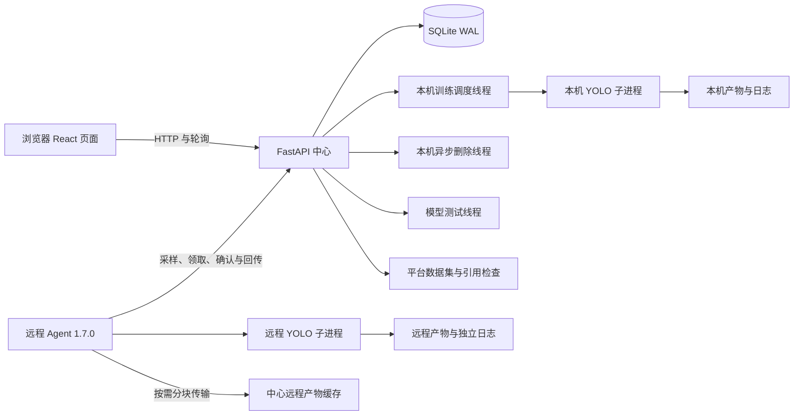

# YOLO Forge 项目分析与维护建议

核查日期：**2026-10-16**。代码基线：开发版 HEAD `91242c5` 及当前工作区。平台前端与 FastAPI 版本为 **1.0.0**，随仓库提供的远程 Agent 为 **1.7.0**。

本文记录当前实现、已验证行为和后续优化顺序。安装入口见 [项目首页](../README.md)，页面操作见 [Web 说明](../web/README.md)，远程执行见 [Agent 说明](../web/agent/README.md)，服务与备份见 [部署说明](../web/deploy/README.md)。

## 当前结论

平台已经具备可用的本机与远程训练闭环，包括任务和 Attempt 历史、参数编辑、检测数据集上传与管理、训练过程解析、实验对比、模型图片测试、远程产物传输以及本机和远程异步清理。侧栏健康状态与平台设置现在读取真实健康接口，不再是静态占位。

本轮最终验证结果：

| 检查 | 结果 | 说明 |
| --- | --- | --- |
| 后端测试 | `199 passed, 1 warning` | 任务、数据集、推理、节点认证、Agent 恢复、领取竞态和远程删除保护测试通过 |
| 前端 lint | 通过 | ESLint 未报告问题 |
| 前端生产构建 | 通过 | TypeScript 与 Vite 构建完成 |
| 健康接口测试 | 通过 | 覆盖数据库正常、核心线程状态、降级状态和数据库不可用的 `503` 响应 |

本轮没有重新执行前端依赖安全审计。lint 与生产构建通过不等于依赖没有已知漏洞。

## 架构和运行边界

中心 API、训练调度器、本机删除线程和模型测试线程位于同一进程。Uvicorn 必须保持一个 worker，同一数据库和状态目录也只能由一个后端实例管理。若要扩展为多 API 实例，需要先分离调度器、文件操作和进程所有权，并将 SQLite 及内存队列替换为适合多实例协调的存储。

远程服务器主动连接中心，不依赖 SSH。每个 Agent Token 只允许访问对应节点的上报、训练和文件操作接口；平台管理页面和普通管理 API 仍没有用户登录认证。

API 接受 `detect`、`segment`、`classify`、`pose`、`obb`，但检测数据集上传、模型图片测试、训练过程解析和主要比较指标仍以 `detect` 为主。任务类型可选择不代表五类任务已经获得同等程度的业务验收。

## 已修复并确认的关键问题

### 本机和远程 GPU 编号已经隔离

[本机调度器](../web/backend/app/services.py)只统计 `execution_node_id` 为空的活动任务。远程 GPU `0` 不再阻塞申请本机 GPU `0` 的任务；本机相同或重叠 GPU 仍会排队，本机不同 GPU 可以并行。

平台根据任务配置的 GPU 编号调度，不检查实时剩余显存，也不限制平台外启动的训练进程。CPU 任务没有 GPU 冲突限制，多个 CPU 任务可能同时启动。

### Agent 1.7.0 已补全领取确认与异常恢复

[远程领取接口](../web/backend/app/compute_nodes.py)为 Agent 1.6.0+ 生成随机租约。新版中心允许同一租约幂等重试确认，并正确处理“领取后、确认前点击停止”；Agent 1.7.0 在响应丢失时使用原租约继续确认，收到 `stop=true` 时不启动 YOLO。

Agent 将活动任务以 `0600` 权限原子写入 `.training-state/active/`，记录 PID、进程启动时钟、启动参数哈希和系统 boot ID。Agent 异常退出但 YOLO 子进程仍存活时，重启后只接管身份完全匹配的进程；无法验证时阻止重复训练并上报失败。共享训练锁的文件描述符会传给 YOLO 子进程，所以 Agent 被强制结束时锁仍保持到训练进程退出；重启 Agent 会识别这一持锁进程。同一节点配置还增加单实例锁。完整远程功能应统一使用 1.7.0。

### 远程停止卡住时可人工解除中心占用

只有远程当前 Attempt 已先发出正常停止请求、状态保持 `stopping` 至少 30 秒时，训练画布才显示“解除占用”。操作员必须先在远程服务器确认该 Attempt 的 YOLO 进程已经结束；请求还会校验当前 `run_id` 和显式确认字段，防止在状态已变化时解除旧 Attempt。成功后将 Attempt 标记为 `interrupted`、清除中心记录的 PID 并释放节点占用；迟到 Agent 上报不能把它改回运行态。该操作不会向远程进程发送信号，误确认会使新任务可能与旧进程同时占用 GPU。

### 远程能力和参数协议已闭环

Agent 会上报真实 YOLO 版本、共享锁占用状态、74 项当前预设参数和输出目录写入能力。中心在创建、编辑、启动、续训和重新训练时校验节点上报的参数集；旧 Agent 不支持新参数时会明确拒绝，不再静默丢弃。

### 远程永久删除已增加实时引用保护

Agent 领取删除指令时，中心重新计算模型、数据集和断点引用。删除指令处于 `pending/running` 时，创建、克隆和修改远程任务不能再引用待删 Attempt 中的文件。输出根目录不存在、允许目录失效或挂载离线时，Agent 返回可重试失败，不再把未验证的路径当作已清理。

### 本机服务重启会尝试重新接管训练进程

[调度恢复逻辑](../web/backend/app/services.py)使用完整命令和进程启动时间识别原训练进程。匹配成功时恢复为运行中并继续管理；匹配失败才标记为已中断。平台不会仅凭相同 PID 接管进程，避免 PID 复用造成误判。

### 数据集发布与删除已增加一致性保护

[数据集上传与管理](../web/backend/app/dataset_uploads.py)使用隐藏工作目录构建完整数据集，再原子发布到最终名称。复制或回执写入失败不会让未完成目录出现在资源列表；目录已发布但成功响应丢失时，重试可以根据管理标记恢复回执。

删除只允许操作平台上传且带有有效标记的数据集。后端会检查全部本机任务，包括回收站任务和通过软链接表达的等价路径；远程任务不会因路径字符串巧合而阻塞本机删除。允许删除时先在锁内原子移入隐藏隔离区，再在锁外递归清理；平台启动和创建新上传时会重试清理残留隔离目录。

### 侧栏和平台设置已接入真实健康状态

[平台布局](../web/frontend/src/components/Layout.tsx)在页面可见时每 30 秒请求 `/api/health`，侧栏会区分检查中、在线与异常。设置弹窗展示数据库、训练调度器、本机文件清理、模型测试线程、平台实例、数据库延迟和训练输出目录，也支持手动重新检查与主题切换。弹窗具有 Escape 关闭、焦点限制和触发器焦点恢复。

## 当前问题与优化优先级

### P0：管理入口没有认证

普通任务、数据集上传、模型测试、节点管理、Token 轮换和永久删除接口没有用户身份验证。服务模板监听 `0.0.0.0`，因此能够访问端口的用户可以调用这些管理接口；CORS 不是访问控制，也不能替代登录认证。

单人可信内网可继续使用。开放给多人、其他网段或公网前，应在反向代理增加 HTTPS 和身份认证；长期方案应增加用户、角色、危险操作权限和统一审计日志。Agent Token 只保护节点接口，不能作为网页管理员认证。

### P1：线程健康可见，但仍不能发现调度停滞

[调度循环](../web/backend/app/services.py)捕获宽泛异常后重试，但没有记录异常或连续失败次数。健康接口及侧栏现在能显示数据库和三个核心工作线程的真实存活状态，但调度线程如果在每轮内部持续失败，仍可能显示 `scheduler=running`。

建议增加调度异常日志、最近一次成功循环时间、连续失败次数、队列最老等待时间和任务阻塞原因。页面应区分 API 可访问、调度正常、远程节点在线和训练环境就绪，避免把单一绿色状态理解为完整链路正常。

### P1：日志和指标读取随数据增长变重

训练画布每 3 秒加载任务、运行、指标、产物、最佳权重、事件和日志。本机日志接口每次读取完整日志文件后截取尾部，指标同步也会重新读取完整 `results.csv`。远程中心只保留日志尾部，因此页面“复制全部”和“下载日志”并不是完整远程日志导出。

建议使用文件偏移量增量读取日志和指标，为完整本机日志提供流式下载接口；远程增加专用完整日志传输或明确只支持尾部快照。历史 Attempt、ANSI 控制字符、空日志和大文件都应纳入验收。

### P1：存储缺少配额、告警和统一回收策略

权重、训练图片、日志、远程产物缓存、远程过程解析、模型测试临时文件和数据库备份分别管理。已隔离的数据集删除目录和过期隐藏发布目录现在会在启动或创建新上传时重试清理，但过期上传会话仍主要在创建下一次上传时清理；远程产物缓存和完成的操作记录主要在永久删除任务时清理；备份脚本不会自动删除旧备份。

建议增加全局与按任务空间统计、低磁盘阈值、缓存有效期、备份保留数量和定时清理任务。训练启动、数据集发布、远程文件准备和模型测试前应使用统一的空间预检策略。

### P1：自动迁移备份不能替代一致备份

[数据库自动迁移](../web/backend/app/database.py)在升级前使用 `shutil.copy2` 复制 SQLite 主文件。数据库启用 WAL 时，该副本不保证包含 WAL 中全部已提交内容。部署目录中的 [Backup API 脚本](../web/deploy/backup_database.py)能够生成一致备份并执行完整性检查，应在升级前显式运行。

建议让迁移流程直接使用 SQLite Backup API，并建立备份保留及恢复演练。数据库、模型、数据集、训练产物、日志和 Agent `.training-state/` 仍需作为不同对象分别备份。

### P2：实验对比只包含当前 Attempt

[实验对比页面](../web/frontend/src/components/ExperimentCompare.tsx)会为每个任务选择当前运行，不会列出该任务的所有历史 Attempt，也不能直接比较同一任务的多次尝试。页面每 5 秒重新请求全部任务及其运行列表，并在浏览器后台继续刷新。

建议提供按运行分页或批量查询接口，让选择器展示任务下的所有 Attempt，支持同一任务内对比，并在页面隐藏或运行已结束时降低刷新频率。

### P2：任务中心更新机制重复

后端已经提供 `/api/stream` SSE，任务中心目前仍每 3 秒轮询 `/api/tasks`，前端没有建立 EventSource。可以选择接入 SSE 并保留断线轮询回退，或删除未使用的流接口，避免长期维护两套更新逻辑。

### P2：版本来源和设置能力仍需统一

前端包和 FastAPI 为 `1.0.0`，后端 `pyproject.toml` 仍为 `0.1.0`。左上角版本来自前端 `package.json`，不会自动校验后端包或数据库结构版本。平台设置现在可查看实例和核心健康状态，但仍不提供 Agent 最低版本、数据根目录、磁盘剩余空间或后端运行配置编辑。

建议建立单一版本源，在构建时注入前后端；再根据运维需求增加只读容量信息或经过权限控制的配置入口，避免把当前状态弹窗误解为已覆盖所有平台配置。

### P2：前端关键流程缺少自动化测试

后端测试覆盖较完整，前端目前只有 lint 与构建检查。建议增加少量端到端测试，覆盖创建任务、停止训练、回收站、历史 Attempt、远程节点、模型测试和实验对比。任务卡片使用可点击 `article`，也应补充键盘访问、焦点管理和对话框关闭行为。

## 推荐实施顺序

| 顺序 | 工作 | 验收重点 |
| --- | --- | --- |
| 1 | 管理入口认证与统一审计 | 未认证用户不能读取资源或执行管理操作；删除、停止、Token 操作可追溯 |
| 2 | 调度、队列和磁盘可观测性 | 调度异常有日志；页面显示排队原因；磁盘不足提前告警 |
| 3 | 增量日志、指标和批量查询 | 大日志与长训练下请求耗时稳定；页面隐藏时停止不必要刷新 |
| 4 | 历史 Attempt 对比与运行状态细化 | 同一任务不同 Attempt 可对比；健康页能显示调度进展与容量信息 |
| 5 | 统一版本、文档和端到端测试 | 一个版本源；发布检查自动验证核心流程及文档版本 |

## 验证范围说明

本轮没有启动新的本机或远程 GPU 训练，没有进行多卡 DDP、断网故障注入、浏览器兼容性、并发压力、完整迁移回滚或备份恢复测试。自动化测试、lint 和生产构建能证明已覆盖的代码路径正常，但不能替代真实模型、数据、CUDA 环境和网络条件下的完整验收。

本轮未启动新的真实 GPU 训练，也未启动、停止或重启平台服务。Agent 部署包会同步到两个指定的 Agent 目录；平台使用版目录不会被修改。
