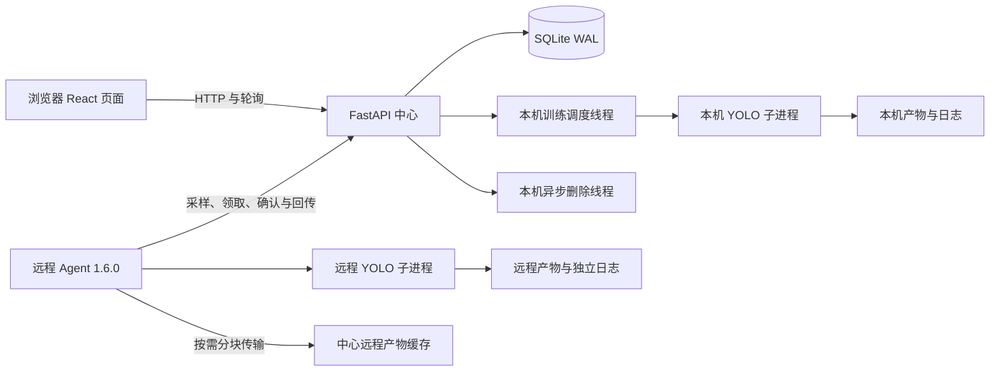

# YOLO Forge 项目分析与维护建议

核查日期：**2026-10-16**。代码基线：`32c1e75` 加本文档更新前的工作区。平台前端与 FastAPI 版本为 **1.0.0**，随仓库提供的远程 Agent 为 **1.6.0**。

本文记录当前实现、已验证行为和后续优化顺序。安装入口见 [项目首页](../README.md)，页面操作见 [Web 说明](../web/README.md)，远程执行见 [Agent 说明](../web/agent/README.md)，服务与备份见 [部署说明](../web/deploy/README.md)。

## 当前结论

平台已经具备可用的本机与远程训练闭环，包括任务和 Attempt 历史、参数编辑、检测数据集上传、训练过程解析、实验对比、模型图片测试、远程产物传输以及本机和远程异步清理。当前开发服务健康，远程节点能够以 Agent 1.6.0 上报训练能力。

本次只读验证结果：

| 检查 | 结果 | 说明 |
| --- | --- | --- |
| 后端测试 | `150 passed`，约 9 秒 | 任务、上传、推理、节点认证、Agent、领取租约和文件操作测试通过 |
| 前端 lint | 通过 | ESLint 未报告问题 |
| 前端生产构建 | 通过 | TypeScript 与 Vite 构建完成 |
| 实时健康接口 | 数据库正常、调度线程和本机删除线程在线 | 只能证明一次查询与线程存活，不能证明真实训练持续取得进展 |
| 远程节点 | 在线，Agent `1.6.0`，训练能力就绪 | 没有在本次核查中启动新的真实 GPU 训练 |
| 当前数据目录 | 约 916 MB | 主要由同一任务的多个权重文件占用 |

前端依赖安全审计没有得出结果：当前配置的华为 npm 镜像对 audit 请求返回 HTTP 405。该结果既不是发现漏洞，也不能证明依赖安全。

## 架构和运行边界

中心 API、训练调度器、本机删除线程和模型测试线程位于同一进程。Uvicorn 必须保持一个 worker，同一数据库和状态目录也只能由一个后端实例管理。若要扩展为多 API 实例，需要先分离调度器、文件操作和进程所有权，并将 SQLite 及内存队列替换为适合多实例协调的存储。

远程服务器主动连接中心，不依赖 SSH。每个 Agent Token 只允许访问对应节点的上报、训练和文件操作接口；平台管理页面和普通管理 API 仍没有用户登录认证。

API 接受 `detect`、`segment`、`classify`、`pose`、`obb`，但检测数据集上传、模型图片测试、训练过程解析和主要比较指标仍以 `detect` 为主。任务类型可选择不代表五类任务已经获得同等程度的业务验收。

## 已修复并确认的关键问题

### 本机和远程 GPU 编号已经隔离

[本机调度器](../web/backend/app/services.py)只统计 `execution_node_id` 为空的活动任务。远程 GPU `0` 不再阻塞申请本机 GPU `0` 的任务；本机相同或重叠 GPU 仍会排队，本机不同 GPU 可以并行。

平台根据任务配置的 GPU 编号调度，不检查实时剩余显存，也不限制平台外启动的训练进程。CPU 任务没有 GPU 冲突限制，多个 CPU 任务可能同时启动。

### Agent 1.6.0 已增加训练领取租约

[远程领取接口](../web/backend/app/compute_nodes.py)为 Agent 1.6.0 生成随机领取租约，Agent 在启动训练前确认领取。未确认的 `starting` 运行在 90 秒后可以重新分发；旧租约不能更新运行，降低领取响应丢失造成长期卡住或重复接管的风险。

中心仍兼容 Agent 1.2.0～1.5.x，这些版本不会获得训练领取租约。远程完整功能应统一升级到 1.6.0，不能把兼容旧 Agent 理解为拥有相同的恢复保证。

### 本机服务重启会尝试重新接管训练进程

[调度恢复逻辑](../web/backend/app/services.py)使用完整命令和进程启动时间识别原训练进程。匹配成功时恢复为运行中并继续管理；匹配失败才标记为已中断。平台不会仅凭相同 PID 接管进程，避免 PID 复用造成误判。

## 当前问题与优化优先级

### P0：管理入口没有认证

普通任务、数据集上传、模型测试、节点管理、Token 轮换和永久删除接口没有用户身份验证。服务模板监听 `0.0.0.0`，因此能够访问端口的用户可以调用这些管理接口；CORS 不是访问控制，也不能替代登录认证。

单人可信内网可继续使用。开放给多人、其他网段或公网前，应在反向代理增加 HTTPS 和身份认证；长期方案应增加用户、角色、危险操作权限和统一审计日志。Agent Token 只保护节点接口，不能作为网页管理员认证。

### P1：远程训练能力校验尚未完全闭环

中心参数目录来自当前源码的 `default.yaml`，Agent 使用固定 `TRAINING_KEYS`，远程实际训练又取决于 Agent 所配置的 YOLO CLI。当前 Agent 能力上报中的 `yolo_version` 为空，`lock_occupied` 固定为 `false`，不能准确说明真实 YOLO 版本或另一个 Agent 是否正持有共享锁。

编辑远程任务时会拒绝 Agent 明确不支持的预设参数，但[创建任务接口](../web/backend/app/main.py)尚未对高级参数执行同样检查。例如中心支持 `cls_remap`，Agent 1.6.0 的固定集合没有该项，创建远程任务时可能保存参数而实际命令没有带上。

建议让 Agent 探测真实 YOLO 版本和参数能力，在创建、编辑、启动和重新训练时使用同一套能力校验，并在任务事件中保存最终命令与被拒绝参数。

### P1：健康检查不能发现调度停滞

[调度循环](../web/backend/app/services.py)捕获宽泛异常后直接重试，没有记录异常。健康接口只检查数据库和线程是否存活；调度线程持续失败时仍可能显示 `scheduler=running`。侧栏的“训练服务在线”又是固定文字，并没有读取健康接口。

建议增加调度异常日志、最近一次成功循环时间、连续失败次数、队列最老等待时间和任务阻塞原因。页面应区分 API 可访问、调度正常、远程节点在线和训练环境就绪，避免把单一绿色状态理解为完整链路正常。

### P1：日志和指标读取随数据增长变重

训练画布每 3 秒加载任务、运行、指标、产物、最佳权重、事件和日志。本机日志接口每次读取完整日志文件后截取尾部，指标同步也会重新读取完整 `results.csv`。远程中心只保留日志尾部，因此页面“复制全部”和“下载日志”并不是完整远程日志导出。

建议使用文件偏移量增量读取日志和指标，为完整本机日志提供流式下载接口；远程增加专用完整日志传输或明确只支持尾部快照。历史 Attempt、ANSI 控制字符、空日志和大文件都应纳入验收。

### P1：存储缺少配额、告警和统一回收策略

权重、训练图片、日志、远程产物缓存、远程过程解析、模型测试临时文件和数据库备份分别管理。数据集上传过期清理只在创建下一次上传时触发；远程产物缓存和完成的操作记录主要在永久删除任务时清理；备份脚本不会自动删除旧备份。

建议增加全局与按任务空间统计、低磁盘阈值、缓存有效期、备份保留数量和定时清理任务。训练启动、数据集发布、远程文件准备和模型测试前应使用统一的空间预检策略。

### P1：自动迁移备份不能替代一致备份

[数据库自动迁移](../web/backend/app/database.py)在升级前使用 `shutil.copy2` 复制 SQLite 主文件。数据库启用 WAL 时，该副本不保证包含 WAL 中全部已提交内容。部署目录中的 [Backup API 脚本](../web/deploy/backup_database.py)能够生成一致备份并执行完整性检查，应在升级前显式运行。

建议让迁移流程直接使用 SQLite Backup API，并建立备份保留及恢复演练。数据库、模型、数据集、训练产物、日志和 Agent `.training-state/` 仍需作为不同对象分别备份。

### P2：实验对比只包含当前 Attempt

[实验对比页面](../web/frontend/src/components/ExperimentCompare.tsx)会为每个任务选择当前运行，不会列出该任务的所有历史 Attempt，也不能直接比较同一任务的多次尝试。页面每 5 秒重新请求全部任务及其运行列表，并在浏览器后台继续刷新。

建议提供按运行分页或批量查询接口，让选择器展示任务下的所有 Attempt，支持同一任务内对比，并在页面隐藏或运行已结束时降低刷新频率。

### P2：任务中心更新机制重复

后端已经提供 `/api/stream` SSE，任务中心目前仍每 3 秒轮询 `/api/tasks`，前端没有建立 EventSource。可以选择接入 SSE 并保留断线轮询回退，或删除未使用的流接口，避免长期维护两套更新逻辑。

### P2：版本来源、设置入口和文档维护

前端包和 FastAPI 为 `1.0.0`，后端 `pyproject.toml` 仍为 `0.1.0`。侧栏“平台设置”按钮没有操作。建议建立单一版本源，在构建时注入前后端，并让设置弹窗显示平台版本、Agent 最低版本、实例名称、健康状态、数据目录和磁盘空间。

### P2：前端关键流程缺少自动化测试

后端测试覆盖较完整，前端目前只有 lint 与构建检查。建议增加少量端到端测试，覆盖创建任务、停止训练、回收站、历史 Attempt、远程节点、模型测试和实验对比。任务卡片使用可点击 `article`，也应补充键盘访问、焦点管理和对话框关闭行为。

## 推荐实施顺序

| 顺序 | 工作 | 验收重点 |
| --- | --- | --- |
| 1 | 管理入口认证与统一审计 | 未认证用户不能读取资源或执行管理操作；删除、停止、Token 操作可追溯 |
| 2 | 远程能力协议闭环 | 创建和编辑使用同一参数校验；显示真实 YOLO/Agent 版本；完整训练要求 Agent 1.6.0 |
| 3 | 调度、队列和磁盘可观测性 | 调度异常有日志；页面显示排队原因；磁盘不足提前告警 |
| 4 | 增量日志、指标和批量查询 | 大日志与长训练下请求耗时稳定；页面隐藏时停止不必要刷新 |
| 5 | 历史 Attempt 对比与真实设置页 | 同一任务不同 Attempt 可对比；服务状态来自健康接口 |
| 6 | 统一版本、文档和端到端测试 | 一个版本源；发布检查自动验证核心流程及文档版本 |

## 验证范围说明

本次没有启动新的本机或远程 GPU 训练，没有进行多卡 DDP、断网故障注入、浏览器兼容性、并发压力、完整迁移回滚或备份恢复测试。现有测试、健康接口和在线节点能证明当前基础状态正常，但不能替代真实模型、数据、CUDA 环境和网络条件下的完整验收。

本次文档更新不修改业务代码、不启动或停止服务，也不复制到使用版目录。
