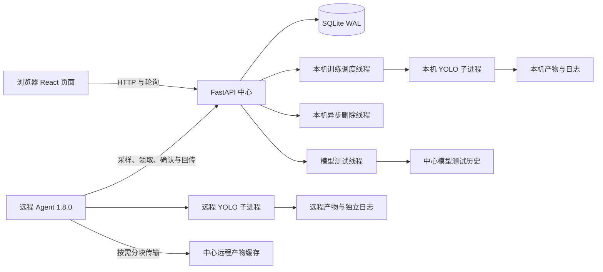

# YOLO Forge 项目分析与维护建议

核查日期：**2026-10-19**。代码基线为当前开发版工作区；平台版本为 **1.1.0**，配套远程 Agent 为 **1.8.0**。

本文记录当前实现、运行边界和后续优化顺序。安装入口见 [项目首页](../README.md)，页面操作见 [Web 说明](../web/README.md)，远程执行见 [Agent 说明](../web/agent/README.md)，服务与备份见 [部署说明](../web/deploy/README.md)。

## 当前结论

平台已具备本机与远程训练闭环，包括任务及 Attempt 历史、参数编辑与校验、检测数据集上传管理、训练过程解析、任意历史 Attempt 对比、模型图片测试、远程产物传输以及本机和远程异步清理。

本轮的重点是减少训练启动与停止竞争、让调度失败可见、收紧输入与删除边界，并让多套中心连接同一远程主机时能按真实输出目录协调。Agent 1.8.0 是当前远程训练的最低版本；旧 Agent 可能仍能上报监控数据，但不能通过新训练的入口门禁。

发布验证应在当前 checkout 上重新执行，不沿用 1.0.0 / 1.7.0 时的用例数量：

| 检查 | 命令或范围 | 边界 |
| --- | --- | --- |
| 后端测试 | `python -m pytest -q web/backend/tests` | 从仓库根目录只收集平台后端用例，避免同时收集上游 Ultralytics 测试 |
| 前端静态检查 | `npm run lint` | 不等于真实浏览器交互验收 |
| 前端生产构建 | `npm run build` | 验证 TypeScript 和 Vite 构建，不验证已运行服务是否加载新产物 |
| Agent 检查 | 三份脚本语法检查与 `--check-config` | 使用各部署目录自己的配置，不覆盖 Token 或路径 |

## 架构和运行边界

中心 API、训练调度器、本机删除线程和模型测试线程位于同一进程。Uvicorn 必须保持一个 worker，同一数据库和状态目录也只能由一个后端实例管理。若要扩展为多 API 实例，需先分离调度器、文件操作和进程所有权，并替换不适合多实例协调的 SQLite 及内存状态。

远程服务器主动连接中心，不依赖 SSH。每个 Agent Token 只允许访问对应节点的上报、训练和文件操作接口；平台管理页面和普通管理 API 仍没有用户登录认证。

API 接受 `detect`、`segment`、`classify`、`pose`、`obb`，但数据集上传、模型图片测试、训练过程解析和主要比较指标仍以 `detect` 为主。任务类型可选择不代表五类任务已获得同等程度的业务验收。

## 1.1.0 已实现的主要优化

### 版本与运行路径来源统一

仓库根目录 `VERSION` 是平台版本的单一源。Vite 构建将它注入左上角品牌；FastAPI 版本和 `/api/health` 也读取它，`PLATFORM_VERSION` 可在特殊打包场景显式覆盖，安装包元数据是源码版本文件不可用时的回退。

本机 `YOLO_BIN` 可显式配置为命令或路径；未设置时先查找当前 Python 环境的 `yolo`，再查找 `PATH`。项目、数据、运行、日志和 SQLite 相对路径从当前 checkout 推导，不依赖启动终端的当前目录。

### 本机调度启动与停止竞争收紧

[本机调度器](../web/backend/app/services.py)只统计 `execution_node_id` 为空的活动任务。远程 GPU `0` 不会阻塞申请本机 GPU `0` 的任务；本机相同或重叠 GPU 仍会排队，本机不同 GPU 可以并行。

队列任务通过带原状态条件的数据库更新原子地进入 `starting`。调度器在 `Popen` 之前持久化运行命令和启动意图，再处理同时到达的停止请求；子进程已创建但数据库写入失败时也有明确的恢复路径。这些保护用于避免两个调度回合或停止竞争重复启动同一 Attempt。

调度循环异常现在会记入服务日志，并在健康接口暴露当前错误、最近错误及时间。当前一轮失败时 `scheduler=error`，下一轮成功后回到 `running`，但保留最近错误供排查。

### 本机文件删除和历史导入更稳健

本机永久删除只接受明确位于运行或运行时根目录下的任务目录。验证时保留末端符号链接本身，遇到顶层或目录树内的符号链接只移除链接，不跟随到指向的外部目录。模型和数据输入路径从不作为任务删除目标。

产物同步会移除已不存在的本地产物记录，避免数据库中继续展示失效文件。历史扫描时的单个损坏 `args.yaml` 只记录警告并跳过该目录，不再中断其他可用历史的导入。

### 参数和续训语义统一

创建和编辑任务会拒绝空白名称、空白优化器和重复 GPU 编号。动态参数根据参数目录校验类型、有限数值和有效范围；非数、无穷值和超界值在进入命令前就被拒绝。

本机与远程续训都使用上一 Attempt 的检查点语义：数据集必须一致，目标总轮数不能与断点状态冲突。需要更换数据集或重置训练计划时应使用“重新训练”。

### Agent 1.8.0 增加训练门禁和共享 workspace 协调

[远程节点服务](../web/backend/app/compute_nodes.py)将最低 Agent 版本统一为 1.8.0。创建、启动、续训、重新训练和领取阶段都检查节点已启用、版本达标、中心接收时间 `last_seen_at` 未过期，以及最近能力上报中 `training.ready=true`。远程时钟落后不会把刚收到的上报误判为离线；Agent 发现自身训练环境未就绪时也会暂停领取新任务。

Agent 在当前系统账户的私有状态目录中为输出根建立层级意向锁。相同或父子输出根互斥，不相交的兄弟根可并行；保护不依赖两份配置的 `training_lock_file` 字符串完全相同。若两个 Agent 另外共用同一个传统锁文件，该锁仍会将不相交的训练串行。workspace owner 使用稳定 `node_id` 生成，不依赖配置文件路径或进程 PID。共享输出根内存在其他存活 Agent 时，永久删除被拒绝并保留可重试状态。由于该状态目录权限为 `0700`，同机多 Agent 必须使用同一专用系统账户才能共享完整保护；不同账户共享传统锁文件无法共享删除 owner 登记。

`yolo_bin` 默认为 `PATH` 中的 `yolo`，`training_cwd` 默认为 Agent 配置文件所在目录，不再预设某台服务器的项目绝对路径。各机器只需在真实有差异时显式覆盖。

### Agent 恢复和远程进程关联更准确

Agent 将活动运行以私有权限原子写入 `.training-state/active/`，记录 PID、进程启动时钟、命令哈希和 boot ID。Agent 重启后只接管身份完全匹配且仍可达的训练进程，不会仅凭 PID 接管。接管进程自然结束而无法获取原退出码时，Agent 1.8.0 结合已完成 Epoch、非空 `best.pt` / `last.pt` 和日志完成标记判定结果：证据足够则标记 `completed`，证据不足则标记 `interrupted` 并保留产物供核对。

算力页的进程只在 `execution_node_id` 与 PID 都匹配时关联到训练任务。本机和远程或两台远程机器上的同号 PID 不会串台显示。

### 实验对比与界面交互完善

[实验对比页](../web/frontend/src/components/ExperimentCompare.tsx)现在列出每个任务的全部历史 Attempt，支持同一任务的不同运行直接对比。选择状态和 URL 使用运行 ID，旧的任务 ID 链接会尽量转换到当前或最近 Attempt。指标列、参数列和已选卡片与实际已选运行数量一致，超出可见宽度时使用横向滚动。

任务中心使用自适应卡片列，算力页根据可用宽度排列 GPU 卡片并将进程表独立横向滚动，训练画布和对比页也补充了宽屏与窄屏规则。核心弹窗共用焦点管理，支持 Esc 关闭、Tab 焦点限定和关闭后恢复到触发控件；窗口缩放时工具栏和正文保持可读。

## 当前问题与优化优先级

### P0：管理入口没有认证

普通任务、数据集上传、模型测试、节点管理、Token 轮换和永久删除接口没有用户身份验证。单人可信内网可继续使用；开放给多人、其他网段或公网前，应在反向代理增加 HTTPS 和身份认证。Agent Token 只保护节点接口，不能代替网页管理员认证。

### P1：日志和指标读取仍会随数据增长变重

训练画布定期加载任务、运行、指标、产物、事件和日志。本机日志接口仍会读取完整文件后截取尾部，指标同步也会重新读取 `results.csv`。远程中心只保留日志尾部，页面的复制与下载不是完整远程日志。

后续应使用文件偏移量增量读取日志和指标，为完整本机日志提供流式下载，并对远程完整日志增加专用传输或保持明确的“尾部快照”语义。

### P1：存储缺少平台级统一配额与告警

模型测试历史已有全局与单任务配额、最低剩余空间和持久预留，但权重、训练图片、日志、远程产物缓存、过程解析、数据集发布和数据库备份仍分别管理。建议将现有配额机制扩展到训练启动、数据集发布和远程文件准备，并在页面展示容量和阈值告警。

### P1：自动迁移备份不能替代一致备份

[数据库自动迁移](../web/backend/app/database.py)在升级前复制 SQLite 主文件，在 WAL 模式下不保证包含 WAL 中的全部已提交内容。[备份脚本](../web/deploy/backup_database.py)使用 SQLite Backup API 并执行完整性检查，应在升级前显式运行。

模型测试历史由 SQLite 索引与 `model-test-history/` 文件共同组成，两者必须在没有活动写入时作为同一备份集保存和恢复。Agent `.training-state/` 也需在远程主机单独保留。

### P2：前端仍同时维护轮询和未使用的 SSE

后端已提供 `/api/stream` SSE，任务中心仍每 3 秒轮询 `/api/tasks`，实验对比每 5 秒重新请求任务和运行列表。可选择接入 SSE 并保留断线轮询回退，或删除未使用的流接口；对比页也应在页面隐藏或入选运行全部结束时降低刷新频率。

### P2：前端关键流程缺少端到端测试

后端对竞争、门禁、恢复和路径边界已有针对性测试，前端仍主要依赖 lint 与构建。建议增加少量真实浏览器端到端测试，覆盖创建与停止、回收站、任意历史 Attempt 对比、远程就绪门禁、模型测试以及弹窗键盘焦点。

## 推荐实施顺序

| 顺序 | 工作 | 验收重点 |
| --- | --- | --- |
| 1 | 增量日志、指标与完整日志导出 | 大日志和长训练下请求耗时稳定，本机与远程导出语义明确 |
| 2 | 平台级容量统计、预检与回收策略 | 训练、数据集和缓存在磁盘耗尽前给出可操作提示 |
| 3 | 轮询收敛与端到端测试 | 隐藏页面不产生无效请求，核心交互和焦点行为可回归 |
| 4 | 多任务类型的功能对齐验收 | `segment` / `classify` / `pose` / `obb` 的数据、指标、测试和对比语义明确 |

## 验证范围说明

自动化测试、lint、生产构建、脚本语法检查和离线配置检查只能证明已覆盖的代码路径。它们不代替真实模型、数据、CUDA / DDP、Agent 崩溃与网络故障、多机时钟偏差、浏览器兼容性、并发压力、完整迁移回滚和备份恢复演练。

发布时应保留各远程 Agent 的真实 `agent-config.json` 和 `.training-state/`，替换脚本后重新执行 `--check-config`。平台后端代码变更需要重启目标服务才会生效；前端代码变更需要重新生成生产构建。
